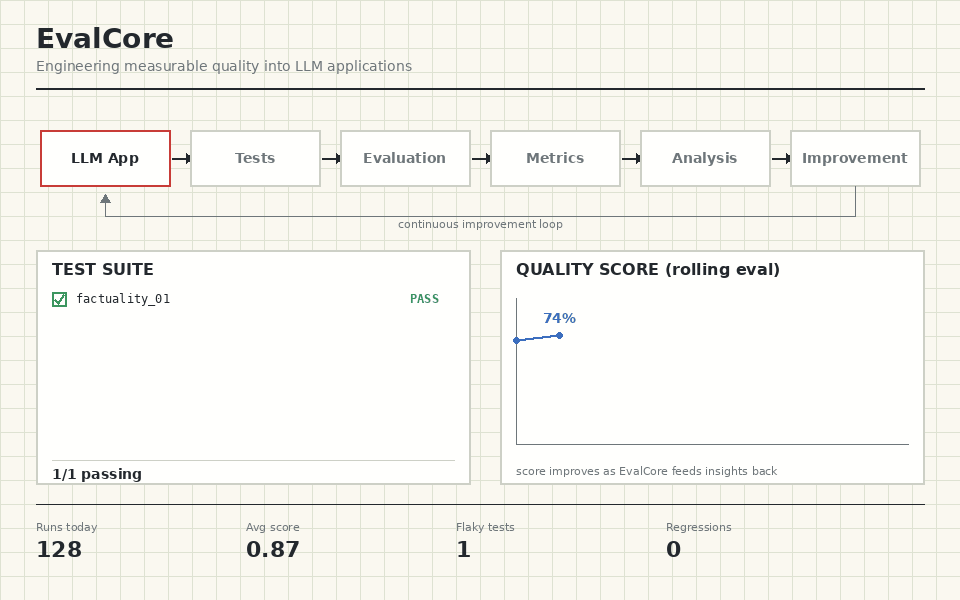

<!-- Top Visual Banner -->

 

<!-- Dynamic Typing SVG Headline -->

  <b>DevOps Engineer</b> &bull; <b>Cloud Reliability Architect</b> &bull; <b>Quant & Distributed Systems Researcher</b>

<!-- Social & Badges Navigation -->

  
  
  
  
  

<!-- Quote / Philosophy -->
<blockquote align="center">
  <i>"Martingale in a world with memory. Fair game, unfair clock."</i> 
  <b>Quant · Cloud Systems · Kubernetes SRE · Autonomous AI · Real-Time Graphics</b>
</blockquote>

---

## ⚡ Executive Summary

I am a **DevOps & Cloud Reliability Engineer** based in India, with hands-on production experience spanning high-scale API platforms, observability pipelines, and Kubernetes control planes. My engineering philosophy revolves around **deterministic resilience**, **zero-downtime automation**, and **low-latency distributed infrastructure**.

- 🔭 **Current Focus**: Architecting self-healing Kubernetes reconciliation engines, automated GitOps deployment lifecycles, and low-latency infrastructure at **SPIRE INFOTECH**.
- 🛠️ **Industry Roots**: Previously optimized high-throughput API workflows at **Hoppscotch**, engineered OpenTelemetry observability pipelines at **SigNoz**, automated e2e service testing at **Keploy**, and contributed to open-source UI platforms at **ToolJet**.
- 🔬 **Research & Quantitative Systems**: Exploring computational finance, stochastic processes, and high-frequency systems at **Occultaeratio** & **FactorFunctionQuant**.
- 🎓 **Academics**: B.Tech (Honors) in Computer Science & Engineering from **KL University** (Grade: **9.02 CGPA**).

---

## 💼 Career Journey & Work Experience

<table width="100%">
  <thead>
    <tr>
      <th width="28%">Role & Company</th>
      <th width="20%">Duration & Location</th>
      <th width="52%">Core Responsibilities & Technical Impact</th>
    </tr>
  </thead>
  <tbody>
    <tr>
      <td>
        <b>DevOps Engineer</b> 
        🏢 <b>SPIRE INFOTECH</b> &bull; Full-Time
      </td>
      <td>
        <code>Oct 2026 – Present</code> 
        📍 Hyderabad, India (Hybrid)
      </td>
      <td>
        &bull; Driving cloud infrastructure operations, containerized workload scaling, and Kubernetes orchestration. 
        &bull; Developing resilient CI/CD delivery pipelines, automated canary rollouts, and GitOps release practices. 
        &bull; Standardizing Infrastructure as Code (IaC) via Terraform, policy-governed environments, and cluster reliability.
      </td>
    </tr>
    <tr>
      <td>
        <b>API Integration Developer</b> 
        🛸 <b>Hoppscotch</b> &bull; Contract / Internship
      </td>
      <td>
        <code>Sep 2025 – Apr 2026</code> 
        ⏱️ 8 months
      </td>
      <td>
        &bull; Optimized API request/response lifecycles, streaming client protocols, and payload serialization. 
        &bull; Implemented multi-protocol authentication mechanisms (OAuth2, Bearer tokens, mTLS) and validation suites. 
        &bull; Enhanced cross-platform integration reliability under high concurrent request volumes.
      </td>
    </tr>
    <tr>
      <td>
        <b>Cloud Reliability Engineer</b> 
        📡 <b>SigNoz</b> &bull; Internship
      </td>
      <td>
        <code>Mar 2025 – Jun 2025</code> 
        ⏱️ 4 months
      </td>
      <td>
        &bull; Built and tuned cloud-native observability infrastructure powered by OpenTelemetry (OTel). 
        &bull; Deployed high-throughput distributed tracing collectors, log aggregation pipelines, and metric stores. 
        &bull; Automated cluster health monitors, alerting thresholds, and infrastructure failure detection workflows.
      </td>
    </tr>
    <tr>
      <td>
        <b>Backend Engineering Associate</b> 
        🧪 <b>Keploy</b> &bull; Internship
      </td>
      <td>
        <code>Jul 2024 – Dec 2024</code> 
        ⏱️ 6 months
      </td>
      <td>
        &bull; Engineered zero-code API test automation and deterministic mock recording engines for distributed microservices. 
        &bull; Streamlined service-to-service dependency validation, regression gates, and CI integration pipelines. 
        &bull; Accelerated troubleshooting workflows and reduced regression cycles across microservice clusters.
      </td>
    </tr>
    <tr>
      <td>
        <b>Open Source UI Contributor</b> 
        ⚡ <b>ToolJet</b> &bull; Open Source
      </td>
      <td>
        <code>Jan 2024 – Jun 2024</code> 
        ⏱️ 6 months
      </td>
      <td>
        &bull; Contributed core frontend modules in React and TypeScript for low-code internal application development. 
        &bull; Optimized layout rendering engines, responsive state synchronization, and complex widget interactions. 
        &bull; Resolved critical UI performance bottlenecks and enhanced cross-browser user experience.
      </td>
    </tr>
  </tbody>
</table>

---

## 🎓 Education & Academic Foundations

<table>
  <tr>
    <td width="75%">
      <h3>🎓 Bachelor of Technology (B.Tech), Honors — Computer Science & Engineering</h3>
      <b>KL University</b> &bull; <code>Jun 2022 – Jun 2026</code> 
      <b>Academic Standing:</b> <kbd>9.02 CGPA</kbd> &bull; <i>First Class with Distinction</i>
        
      <b>Core Coursework & Research:</b> 
      Advanced Data Structures & Algorithms &bull; Distributed Operating Systems &bull; Database Engine Internals &bull; Computer Networks & Protocols &bull; Cloud Infrastructure &bull; Compilers & Systems Programming &bull; High-Performance Computing.
    </td>
    <td width="25%" align="center">
      
        
      
    </td>
  </tr>
</table>

---

## 🏆 Top 10 Flagship Projects & Live Workflows

Here is a curated showcase of my top 10 engineering projects, featuring real-world system architecture, live workflow previews, and production-grade implementations.

---

### 1. 🛡️ [TargetReconciliationService](https://github.com/ATLURI0001/target-reconciliation-service)
> **Kubernetes-native reliability control plane for policy-driven automated recovery, reconciliation & auditable incident remediation.**

  

- **Tech Stack:** `Go 1.24+` &bull; `Kubernetes CRD Reconciler` &bull; `controller-runtime` &bull; `PostgreSQL` &bull; `Next.js` &bull; `Prometheus` &bull; `Grafana`
- **Key Highlights:**
  - Custom `ReliabilityTarget` CRD orchestrating real-time failure detection, deterministic explainable rollbacks, and atomic image preconditions.
  - PostgreSQL-backed transactional event timeline with immutable audit guarantees and zero in-memory fallback.
  - Complete read-only Next.js operator console, Prometheus metrics exporter, and Kind integration test harness.

---

### 2. 🪞 [NeuroMirror](https://github.com/ATLURI0001/NeuroMirror)
> **Real-time client-side Augmented Reality anatomical & neural X-ray mirror in your browser at 60 FPS.**

  

- **Tech Stack:** `Three.js (WebGL 2.0)` &bull; `Google MediaPipe Tasks Vision` &bull; `GLSL Shaders` &bull; `WebAssembly` &bull; `JavaScript (ES6)`
- **Key Highlights:**
  - Tracks 478 3D facial landmarks and 21 articulated hand joints completely client-side with zero server latency.
  - Dynamic TMJ jaw kinematics: 3D mandible bone rotates synchronously around its anatomical hinge as you speak or yawn.
  - Custom GLSL holographic Fresnel X-ray shaders, interactive flashlight lens reveals, and real-time 3D billboarded annotations.

---

### 3. 🏡 [BuildSite](https://github.com/ATLURI0001/BuildSite)
> **Your GitHub Builds Your Home. Turn verified commits into an evolving, photorealistic 3D architectural estate inside your README.**

  

- **Tech Stack:** `Python 3.10+` &bull; `Blender 4.x PBR` &bull; `SVG Compositor` &bull; `GitHub Actions` &bull; `GraphQL API`
- **Key Highlights:**
  - Hybrid 2-stage graphics architecture: Blender physically based rendering combined with an ultra-fast (<200ms) vector compositor.
  - Deterministically transforms developer commits, PRs, and reviews into progressive architectural milestones (Foundations &rarr; Framing &rarr; Pool &rarr; Villa).
  - Generates self-contained, standards-compliant SVG documents with zero external dependencies or API fees.

---

### 4. 🌐 [Synoptic](https://github.com/ATLURI0001/Synoptic)
> **Real-time geospatial intelligence platform for tracking global entity movement and live spatial telemetry.**

  

- **Tech Stack:** `JavaScript` &bull; `CesiumJS` &bull; `WebGL` &bull; `WebSockets` &bull; `Spatial Telemetry Engine`
- **Key Highlights:**
  - High-frequency ingestion of global geospatial data feeds with real-time trajectory visualization and predictive pathing.
  - 3D planetary rendering with hardware-accelerated entity clustering and dynamic spatial heatmaps.
  - Mission-control dashboard displaying multi-source telemetry, altitude vectors, and situational intelligence.

---

### 5. 🗺️ [StrataGlyph](https://github.com/ATLURI0001/StrataGlyph)
> **Declarative cloud architecture engine translating YAML specifications into animated, publication-ready cloud diagrams.**

  

- **Tech Stack:** `TypeScript` &bull; `Vector Graphics Engine` &bull; `Model Context Protocol (MCP)` &bull; `Draw.io Integration`
- **Key Highlights:**
  - Converts concise declarative YAML definitions into interactive, layered AWS/GCP/Kubernetes topology diagrams.
  - Multi-target export support: responsive SVGs, Draw.io XML schemas, PNG assets, and standalone React components.
  - Plugs natively into AI coding assistants via Model Context Protocol (MCP) for automated system design generation.

---

### 6. ⚙️ [EvalCore](https://github.com/ATLURI0001/EvalCore)
> **Engineering measurable quality for LLM applications through evaluation, assertion-driven scoring, and continuous regression gates.**

  

- **Tech Stack:** `Python` &bull; `LLM Evals` &bull; `PyTest Engine` &bull; `CI/CD Automation` &bull; `Statistical Scoring`
- **Key Highlights:**
  - End-to-end framework for quantifying model hallucination, semantic drift, rubric compliance, and latency metrics.
  - Automated CI regression gates blocking non-deterministic model regressions before landing in production.
  - Granular test suites, automated failure trace analysis, and versioned evaluation leaderboards.

---

### 7. ☁️ [Agentcore-Architecture-Harness](https://github.com/ATLURI0001/Agentcore-Architecture-Harness)
> **Autonomous AWS architecture agent deployed on Amazon Bedrock AgentCore with IAM-controlled MCP tools.**

  

- **Tech Stack:** `TypeScript` &bull; `Amazon Bedrock AgentCore` &bull; `Terraform` &bull; `AWS IAM` &bull; `Model Context Protocol (MCP)`
- **Key Highlights:**
  - Production agent runtime integrating Bedrock LLMs with secure, scoped MCP tool execution for cloud architecture modeling.
  - Automated generation of Well-Architected AWS topologies, Terraform modules, and cost estimates.
  - Strict IAM authorization boundaries and credential isolation preventing privilege escalation during tool invocations.

---

### 8. 💸 [Token-Tariff](https://github.com/ATLURI0001/Token-Tariff)
> **Audit developer agent setups, estimate LLM token spend from local usage, and simulate cost-reduction strategies.**

  

- **Tech Stack:** `Python` &bull; `CLI Architecture` &bull; `Static Analysis` &bull; `Prompt Caching Modeling`
- **Key Highlights:**
  - Parses developer agent activity, conversation trajectories, and cache utilization to pinpoint token leakage.
  - Simulates model tier substitutions (Claude 3.7 Sonnet &rarr; Haiku) and prompt-caching savings.
  - Generates actionable terminal reports and markdown breakdowns for engineering team cost attribution.

---

### 9. 🪙 [PioneerCrypto](https://github.com/ATLURI0001/PioneerCrypto)
> **Decentralized rails for digital ownership, smart contract verification, and high-integrity financial primitives.**

  

- **Tech Stack:** `TypeScript` &bull; `Web3` &bull; `Solidity` &bull; `Ethereum / EVM` &bull; `Decentralized Protocols`
- **Key Highlights:**
  - Resilient smart contract architecture with audited ownership standards and tokenized asset management.
  - Web3 wallet interaction layers, deterministic state verification, and on-chain event listeners.
  - Explores cryptographic settlement mechanisms and decentralized finance (DeFi) primitives.

---

### 10. 📚 [LMS — Enterprise Multi-Stack Platform](https://github.com/ATLURI0001/LMS)
> **Comprehensive Learning Management System built across Python, Java Spring Boot, and MERN stacks.**

  

- **Tech Stack:** `JavaScript (React / Node.js)` &bull; `Java (Spring Boot)` &bull; `Python` &bull; `PostgreSQL` &bull; `Docker`
- **Key Highlights:**
  - 85+ GitHub Stars: Highly modular architecture supporting enterprise academic workflows and course management.
  - Role-based access control (RBAC), multi-tenant student/faculty portals, and automated assessment evaluation.
  - Containerized deployment with Docker and integrated microservice orchestration.

---

## 🛠️ Technical Arsenal & Core Stack

| Domain | Technologies & Frameworks |
|:---|:---|
| **Cloud & DevOps** |        |
| **Observability & SRE** |     |
| **Languages & Core** |        |
| **AI, Web & Graphics** |      |
| **Data & Storage** |     |

---

## 📊 Real-Time GitHub Analytics & Activity

<table>
  <tr>
    <td width="50%">
      
    </td>
    <td width="50%">
      
    </td>
  </tr>
  <tr>
    <td colspan="2" align="center">
      
    </td>
  </tr>
</table>

  

---

## 📬 Let's Connect & Collaborate

Whether you want to discuss **cloud-native resilience**, **Kubernetes control planes**, **quant & stochastic models**, or **open-source engineering** — my inbox is always open!

&nbsp;

&nbsp;

  

Designed & Architected with precision by <b>Ram Prasad Atluri</b> &bull; Built for the modern web & cloud.

