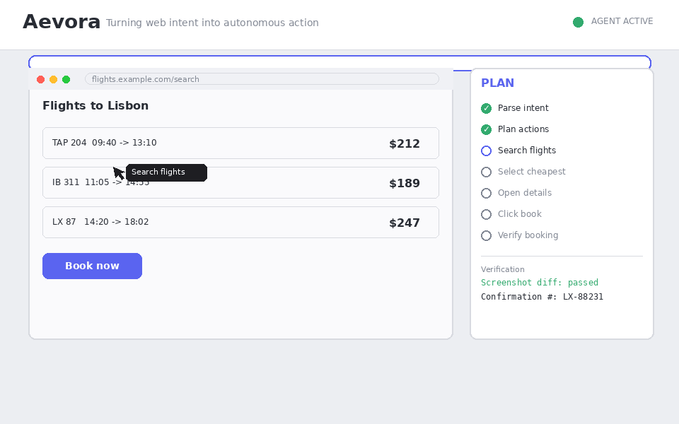
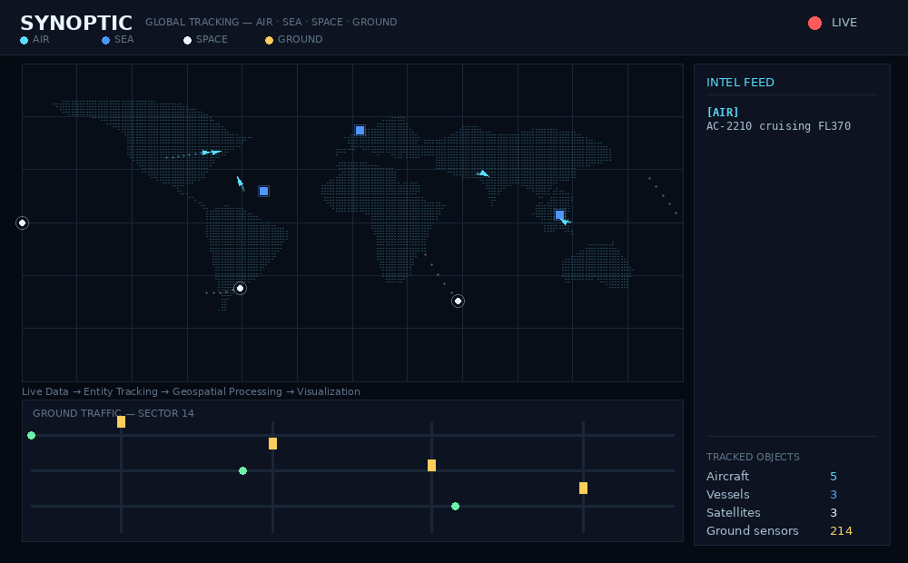

<div align="center">

<!-- TOP RETRO BANNER -->


<br/>

<!-- RETRO ARCADE ANIMATED HEADLINE -->
<a href="https://github.com/ATLURI0001">
  
</a>

<p align="center">
  
  
  
  
</p>

<!-- RETRO ARCADE HUD -->
```
╔═══════════════════════════════════════════════════════════════════════════════════════════════════════════╗
║  🕹️ [FLAGSHIP REPO MATRIX]   •   ARCHITECT: RAM PRASAD ATLURI   •   STATUS: [37 SYSTEMS DEPLOYED]        ║
║  ├── [SECTOR 01] AUTONOMOUS AGENTS & MULTI-AGENT SWARMS (EDWIN, DevPlatform, Runloop, Aevora...)          ║
║  ├── [SECTOR 02] AI EVALUATION, SAFETY & ZERO-DRIFT GATES (Eval-Boundary-Controller, RAG-Attest...)      ║
║  ├── [SECTOR 03] CLOUD RELIABILITY, K8S SRE & DISTRIBUTED ENGINES (target-reconciliation-service...)     ║
║  ├── [SECTOR 04] BARE-METAL PERFORMANCE & HIGH-THROUGHPUT LABS (CoreMach9, LoadMach9...)                 ║
║  ├── [SECTOR 05] QUANT PROTOCOLS & RESPONSIBLE GAME THEORY (PioneerCrypto, HouseScript...)                ║
║  └── [SECTOR 06] COMPUTER VISION, SPATIAL OSINT & REAL-TIME GRAPHICS (NeuroMirror, BuildSite, Synoptic...)║
╚═══════════════════════════════════════════════════════════════════════════════════════════════════════════╝
```

</div>

---

### 👾 SECTOR 01 // AUTONOMOUS AGENTS & MULTI-AGENT SWARMS
> *Self-directed agent swarms, autonomous browser operations, and cognitive developer workflows.*

```
[SYSTEM ALERT] :: MULTI-AGENT SWARMS ARMED • EVENT LOOPS RUNNING • AUTONOMOUS SDLC ACTIVE
```

#### 1. 🕶️ [EDWIN](https://github.com/ATLURI0001/EDWIN) &nbsp; <kbd>AUTONOMOUS OSINT</kbd> &nbsp; <kbd>SWARM INTELLIGENCE</kbd>
> **The Pitch:** Real-time autonomous vision & agentic swarm OSINT platform connecting smart-glasses biometrics to live dossier intelligence in seconds.
- **Key Architecture:** Streams POV video feeds into a low-latency edge pipeline, extracts biometric facial vectors, and deploys parallel agent swarms across open-source web graphs to generate cited intelligence dossiers in under 5s.
- **Tech Stack:** `Python` &bull; `FastAPI` &bull; `Computer Vision` &bull; `Agent Swarms` &bull; `Vector Search` &bull; `WebSockets` &bull; `OpenCV`

#### 2. 🧠⚙️ [DevPlatform](https://github.com/ATLURI0001/DevPlatform) &nbsp; <kbd>CONTROL PLANE</kbd> &nbsp; <kbd>AI-NATIVE SDLC</kbd>
> **The Pitch:** Engineering control plane for AI-native software delivery—orchestrating coding agents, ephemeral git worktrees, and self-healing CI pipelines.
- **Key Architecture:** Manages concurrent coding agent lifecycles in deterministic Docker sandboxes with policy-driven regression guards, automated worktree branching, and step-by-step trajectory token accounting.
- **Tech Stack:** `Go` &bull; `Kubernetes` &bull; `Docker Engine` &bull; `TypeScript` &bull; `Next.js 15` &bull; `gRPC`

#### 3. 🤖 [Runloop](https://github.com/ATLURI0001/Runloop) &nbsp; <kbd>AUTONOMOUS SWE</kbd> &nbsp; <kbd>EXECUTABLE WORKFLOWS</kbd>
> **The Pitch:** Autonomous software engineering agent that parses complex developer task prompts and executes full-cycle coding, debugging, and verification loops.
- **Key Architecture:** Performs AST code inspection and multi-file dependency graph resolution in sandboxed Docker containers, dynamically iterating on failing unit tests until zero regressions remain.
- **Tech Stack:** `Python` &bull; `LangGraph` &bull; `Docker API` &bull; `AST Diffing` &bull; `Git Automation` &bull; `PyTest`

#### 4. 🌐 [Aevora](https://github.com/ATLURI0001/Aevora) &nbsp; <kbd>AUTONOMOUS WEB</kbd> &nbsp; <kbd>VISION AGENT</kbd>
> **The Pitch:** Turning high-level natural language web intent into autonomous, verifiable browser actions across complex interactive web apps.

<p align="center">
  
</p>

- **Key Architecture:** Pairs vision-augmented DOM parsing with accessibility tree inspection to handle dynamic SPAs and multi-factor flows with zero brittle selectors, emitting cryptographically verified action receipts.
- **Tech Stack:** `TypeScript` &bull; `Playwright` &bull; `Chrome DevTools Protocol (CDP)` &bull; `Vision LLMs` &bull; `Node.js`

#### 5. 🔍 [DiffMind](https://github.com/ATLURI0001/DiffMind) &nbsp; <kbd>AI PR AUDITOR</kbd> &nbsp; <kbd>CODE INTELLIGENCE</kbd>
> **The Pitch:** AI-driven pull request intelligence engine providing automated architectural risk analysis, semantic diff indexing, and actionable engineering reviews.
- **Key Architecture:** Deep semantic Tree-Sitter AST diffing categorizing changes into breaking API mutations, security risks, and optimization wins, paired with blast-radius estimation and GitHub bot PR annotations.
- **Tech Stack:** `Python` &bull; `Tree-Sitter` &bull; `GitHub API` &bull; `LLM Reasoning` &bull; `Static Analysis`

#### 6. 🔥 [GraphForge](https://github.com/ATLURI0001/GraphForge) &nbsp; <kbd>LANGGRAPH LAB</kbd> &nbsp; <kbd>STATEFUL WORKFLOWS</kbd>
> **The Pitch:** Interactive playground and testing harness for architecting, visualizing, and mastering stateful multi-agent workflows using LangGraph.

<p align="center">
  
</p>

- **Key Architecture:** Real-time DAG visualizer displaying agent state mutations and cyclic transitions, featuring checkpoint rewind for time-travel debugging and tool execution latency benchmarking.
- **Tech Stack:** `Python` &bull; `LangGraph` &bull; `FastAPI` &bull; `React Flow` &bull; `TypeScript` &bull; `WebSockets`

---

### 🛡️ SECTOR 02 // AI EVALUATION, SAFETY & ZERO-DRIFT GATES
> *Deterministic release gates, sub-millisecond fact verification, and edge attestation engines.*

```
[SYSTEM ALERT] :: 45K+ EVALS/SEC • 95% WILSON CONFIDENCE • ZERO DRIFT ENFORCED
```

#### 7. 🛡️ [Eval-Boundary-Controller](https://github.com/ATLURI0001/Eval-Boundary-Controller) &nbsp; <kbd>RUST</kbd> &nbsp; <kbd>WILSON 95% CI</kbd> &nbsp; <kbd>ZERO DRIFT</kbd>
> **The Pitch:** Declarative evaluation boundary controller written in Rust—enforcing predictive blast-radius selection, 95% Wilson confidence intervals, and zero-drift release gates for AI pipelines.
- **Key Architecture:** Sub-millisecond evaluation gatekeeper preventing stochastic model updates from breaking invariants, computing Wilson score intervals to mathematically bound evaluation uncertainty.
- **Tech Stack:** `Rust` &bull; `Statistical Inference` &bull; `Wilson Score Intervals` &bull; `CI/CD Gates` &bull; `Zero-Alloc`

#### 8. 🎯 [LLM-Hallucination-Detector](https://github.com/ATLURI0001/LLM-Hallucination-Detector) &nbsp; <kbd>SUB-MS GO ENGINE</kbd> &nbsp; <kbd>FACT VERIFICATION</kbd>
> **The Pitch:** High-precision, sub-millisecond LLM hallucination and fact-verification engine in Go—decomposing claims, grounding against source context, and detecting numeric distortions.
- **Key Architecture:** Decomposes streaming model outputs into atomic claim assertions and grounds them against source context via high-concurrency Goroutines in under 5ms.
- **Tech Stack:** `Go` &bull; `Vector Embeddings` &bull; `NLI Grounding` &bull; `High-Concurrency Goroutines` &bull; `gRPC`

#### 9. ⚡ [RAG-Attest](https://github.com/ATLURI0001/RAG-Attest) &nbsp; <kbd>ZIG 45K+ EVALS/S</kbd> &nbsp; <kbd>EDGE ATTESTATION</kbd> &nbsp; <kbd>RAG-L DSL</kbd>
> **The Pitch:** Ultra-fast, zero-cloud Edge RAG evaluation & claim attestation engine powered by Zig (45,000+ evals/sec) and a custom RAG-L Domain-Specific Language.
- **Key Architecture:** Native zero-dependency binary running directly on edge gateways, executing RAG-L semantic rules to validate context relevancy and factual groundedness at memory speed.
- **Tech Stack:** `Zig` &bull; `RAG-L DSL` &bull; `Edge Computing` &bull; `SIMD Instructions` &bull; `Zero-Alloc`

#### 10. ⚙️ [EvalCore](https://github.com/ATLURI0001/EvalCore) &nbsp; <kbd>QUALITY ENGINEERING</kbd> &nbsp; <kbd>REGRESSION GATES</kbd>
> **The Pitch:** Engineering measurable quality for LLM applications through evaluation, assertion-driven scoring, and continuous regression gates.

<p align="center">
  
</p>

- **Key Architecture:** Automated CI regression gates quantifying model hallucination, semantic drift, rubric compliance, and latency metrics to block regressions before production cutovers.
- **Tech Stack:** `Python` &bull; `PyTest Engine` &bull; `LLM Evals` &bull; `Statistical Scoring` &bull; `CI/CD Workflows`

#### 11. 🧪 [PromptTestKit](https://github.com/ATLURI0001/PromptTestKit) &nbsp; <kbd>PROMPT EVOLUTION</kbd> &nbsp; <kbd>DIFF TESTING</kbd>
> **The Pitch:** Evaluation infrastructure for prompt evolution—versioned test suites, assertion-driven scoring, and granular regression gates turning behavioral changes into auditable release decisions.
- **Key Architecture:** Declarative assertion matrices, semantic fuzzy matchers, and token spend drift calculators isolating output variations across prompt updates.
- **Tech Stack:** `TypeScript` &bull; `Node.js` &bull; `Vitest` &bull; `Prompt Engineering` &bull; `Drift Analytics`

#### 12. 🔍 [Model-Lens](https://github.com/ATLURI0001/Model-Lens) &nbsp; <kbd>AI OBSERVABILITY</kbd> &nbsp; <kbd>OTEL TRACING</kbd>
> **The Pitch:** AI observability & distributed tracing platform tailored for LLMs and agentic swarms, capturing token burn, latency bottlenecks, and call hierarchies.
- **Key Architecture:** OpenTelemetry-native trace propagation tracking nested agent tool calls, streaming spans, Time-to-First-Token (TTFT), and token-cost economics across providers.
- **Tech Stack:** `Go` &bull; `OpenTelemetry` &bull; `ClickHouse` &bull; `Next.js 15` &bull; `Prometheus`

#### 13. 🧠 [Oriel](https://github.com/ATLURI0001/Oriel) &nbsp; <kbd>SEMANTIC SEARCH</kbd> &nbsp; <kbd>HYBRID RETRIEVAL</kbd>
> **The Pitch:** High-performance semantic search and knowledge retrieval engine built specifically for AI architectures and retrieval-augmented generation.

<p align="center">
  
</p>

- **Key Architecture:** Hybrid dense vector and BM25 sparse keyword retrieval with reciprocal rank fusion (RRF) and integrated cross-encoder reranking delivering sub-10ms query latency.
- **Tech Stack:** `Python` &bull; `FAISS` &bull; `FastAPI` &bull; `HuggingFace Transformers` &bull; `Redis`

---

### ☸️ SECTOR 03 // CLOUD RELIABILITY, K8S SRE & DISTRIBUTED ENGINES
> *Self-healing Kubernetes control planes, zero-trust MCP boundaries, and enterprise multi-account governance.*

```
[SYSTEM ALERT] :: RECONCILIATION ACTIVE • ZERO-DOWNTIME CANARY • ZERO-TRUST BOUNDARIES
```

#### 14. ☸️ [target-reconciliation-service](https://github.com/ATLURI0001/target-reconciliation-service) &nbsp; <kbd>K8S CRD</kbd> &nbsp; <kbd>SELF-HEALING</kbd>
> **The Pitch:** Kubernetes-native reliability control plane orchestrating policy-driven reconciliation, automated workload recovery, failure remediation, and auditable infrastructure operations.

<p align="center">
  
</p>

- **Key Architecture:** Custom `ReliabilityTarget` CRD in Go orchestrating automated crashLoopBackoff healing and deterministic rollbacks with a PostgreSQL transactional audit timeline and Next.js console.
- **Tech Stack:** `Go 1.24+` &bull; `Kubernetes CRD` &bull; `controller-runtime` &bull; `PostgreSQL` &bull; `Next.js` &bull; `Prometheus`

#### 15. 🔒 [mcp-authz-proxy](https://github.com/ATLURI0001/mcp-authz-proxy) &nbsp; <kbd>MCP BOUNDARY</kbd> &nbsp; <kbd>ZERO-TRUST GO</kbd>
> **The Pitch:** An authorization boundary for Model Context Protocol (MCP) tools—built in Go to enforce who can execute what, isolate credentials, and make every approved action traceable.
- **Key Architecture:** Intercepts JSON-RPC tool calls, enforces fine-grained RBAC policies, isolates sensitive credentials from prompt context, and triggers human approvals for high-risk actions.
- **Tech Stack:** `Go` &bull; `Model Context Protocol (MCP)` &bull; `OAuth2 / mTLS` &bull; `Zero-Trust` &bull; `JSON-RPC`

#### 16. 🚀 [RouteKernel](https://github.com/ATLURI0001/RouteKernel) &nbsp; <kbd>EDGE INFRASTRUCTURE</kbd> &nbsp; <kbd>EPOLL / TLS 1.3</kbd>
> **The Pitch:** High-performance edge infrastructure for reverse proxying, TLS termination, load balancing, traffic control, and real-time observability.
- **Key Architecture:** Event-driven Linux `epoll` network core handling tens of thousands of idle connections with zero-downtime certificate reloads and leaky-bucket rate limiting.
- **Tech Stack:** `C++` &bull; `OpenSSL` &bull; `epoll` &bull; `Prometheus Metrics` &bull; `High-Throughput Networking`

#### 17. 🧭 [Mcp-Server-Atlas](https://github.com/ATLURI0001/Mcp-Server-Atlas) &nbsp; <kbd>MCP DIRECTORY</kbd> &nbsp; <kbd>591+ SERVERS</kbd>
> **The Pitch:** Explore 591 Model Context Protocol (MCP) servers across 21 categories with automated submission checks and link monitoring.
- **Key Architecture:** Automated GitHub Actions crawler continuously validating upstream repository health, schema compliance, and release updates across 21 tool categories.
- **Tech Stack:** `TypeScript` &bull; `Next.js 15` &bull; `GitHub API Crawler` &bull; `TailwindCSS`

#### 18. 💸 [Token-Tariff](https://github.com/ATLURI0001/Token-Tariff) &nbsp; <kbd>TOKEN AUDITOR</kbd> &nbsp; <kbd>COST ARBITRAGE</kbd>
> **The Pitch:** Audit your Claude Code setup, estimate token spend from local usage trajectories, and see which model, caching, and configuration changes reduce costs.

<p align="center">
  
</p>

- **Key Architecture:** Static trajectory analysis calculating prompt cache hit rates and context inflation, simulating model substitutions (Sonnet vs Haiku) to find optimal cost trade-offs.
- **Tech Stack:** `Python` &bull; `Rich CLI` &bull; `Static Analysis` &bull; `Prompt Caching Modeling`

#### 19. ☁️ [Agentcore-Architecture-Harness](https://github.com/ATLURI0001/Agentcore-Architecture-Harness) &nbsp; <kbd>AWS BEDROCK</kbd> &nbsp; <kbd>TERRAFORM ARCHITECT</kbd>
> **The Pitch:** Deploy an AWS architecture agent on Amazon Bedrock AgentCore with Terraform, IAM-controlled MCP tools, architecture diagrams, and design document generation.

<p align="center">
  
</p>

- **Key Architecture:** Bedrock agent runtime generating Well-Architected AWS topologies and production Terraform modules with strict IAM authorization boundaries.
- **Tech Stack:** `TypeScript` &bull; `Amazon Bedrock AgentCore` &bull; `Terraform` &bull; `AWS IAM` &bull; `MCP`

#### 20. 🚦 [Terraform-aws-ecs-blue-green](https://github.com/ATLURI0001/Terraform-aws-ecs-blue-green) &nbsp; <kbd>ZERO-DOWNTIME</kbd> &nbsp; <kbd>AWS ECS</kbd>
> **The Pitch:** Blue/green deployments for Amazon ECS with Terraform, canary traffic shifting, health-alarm rollback, and CI/CD across dev, test, and production.
- **Key Architecture:** AWS CodeDeploy integration with canary traffic shifting and automated CloudWatch alarm rollbacks for zero-downtime container updates.
- **Tech Stack:** `Terraform` &bull; `AWS ECS (Fargate)` &bull; `AWS CodeDeploy` &bull; `CloudWatch Alarms` &bull; `GitHub Actions`

#### 21. 🏛️ [Terraform-Org-Governance](https://github.com/ATLURI0001/Terraform-Org-Governance) &nbsp; <kbd>AWS GOVERNANCE</kbd> &nbsp; <kbd>CONTROL TOWER</kbd>
> **The Pitch:** Govern AWS Organizations with Terraform. Manage organizational units, six policy types, AWS Control Tower controls, and delegated administration for 14 AWS services.
- **Key Architecture:** Declarative management of OUs, SCP guardrails, and compliance policies with automated account provisioning and centralized logging.
- **Tech Stack:** `Terraform` &bull; `AWS Organizations` &bull; `AWS Control Tower` &bull; `IAM Identity Center` &bull; `Security Hub`

#### 22. 🖼️ [Sagemaker-Vision-MLops](https://github.com/ATLURI0001/Sagemaker-Vision-MLops) &nbsp; <kbd>TERRAFORM MLOPS</kbd> &nbsp; <kbd>SAGEMAKER</kbd>
> **The Pitch:** Terraform-powered MLOps for binary image classification on Amazon SageMaker AI, with parallel model training, quality checks, endpoint deployment, and drift monitoring.
- **Key Architecture:** End-to-end automated training pipelines, endpoint canary splitting, and SageMaker Model Monitor tracking feature drift in real-time.
- **Tech Stack:** `Terraform` &bull; `Amazon SageMaker` &bull; `Python` &bull; `PyTorch` &bull; `AWS Lambda` &bull; `S3`

---

### ⚡ SECTOR 04 // BARE-METAL PERFORMANCE & HIGH-THROUGHPUT LABS
> *Benchmarking C++ Drogon, RapidJSON, multicore Node.js, and saturation load testing.*

```
[SYSTEM ALERT] :: DROGON C++ 250K+ RPS • RAPIDJSON DOM/SAX • ZERO GC OVERHEAD
```

#### 23. ⚡ [CoreMach9](https://github.com/ATLURI0001/CoreMach9) &nbsp; <kbd>C++20 DROGON</kbd> &nbsp; <kbd>RAPIDJSON</kbd> &nbsp; <kbd>BARE-METAL</kbd>
> **The Pitch:** CoreMach9 puts every core to work. A C++ HTTP performance lab built with Drogon and RapidJSON to explore how native concurrency and JSON processing shape throughput and latency under load.
- **Key Architecture:** Harnesses Drogon non-blocking event loops and epoll multiplexing to push 250,000+ RPS, evaluating cache line alignment and RapidJSON memory modes.
- **Tech Stack:** `C++20` &bull; `Drogon Framework` &bull; `RapidJSON` &bull; `epoll` &bull; `Linux Perf` &bull; `Flamegraphs`

#### 24. 💥 [LoadMach9](https://github.com/ATLURI0001/LoadMach9) &nbsp; <kbd>NODE.JS EXTREME</kbd> &nbsp; <kbd>FASTIFY VS EXPRESS</kbd>
> **The Pitch:** Push Node.js to its limits. Benchmark requests/sec, latency, and error rates across Express, Fastify, and Cpeak. Explore PostgreSQL tuning, Redis acceleration, and multicore scaling.
- **Key Architecture:** Multi-framework stress testing under 100k concurrent connections with Autocannon/k6, PostgreSQL connection pool tuning, and V8 GC pause profiling.
- **Tech Stack:** `Node.js (v22+)` &bull; `Fastify` &bull; `Express` &bull; `PostgreSQL` &bull; `Redis` &bull; `Autocannon`

#### 25. 🏎️ [FrameworkFaceoff](https://github.com/ATLURI0001/FrameworkFaceoff) &nbsp; <kbd>CROSS-RUNTIME</kbd> &nbsp; <kbd>HARDWARE BENCHMARK</kbd>
> **The Pitch:** A benchmarking platform running web frameworks through comparable workloads—from basic HTTP to JSON processing, database queries, gRPC, and WebSockets.
- **Key Architecture:** Standardized workload harness capturing real-time CPU throttling, memory saturation, and p99.9 latency curves under scaling concurrency.
- **Tech Stack:** `Go` &bull; `Rust (Actix/Axum)` &bull; `Node.js` &bull; `Python (FastAPI)` &bull; `Docker` &bull; `k6`

---

### 🪙 SECTOR 05 // QUANT PROTOCOLS & RESPONSIBLE GAME THEORY
> *Decentralized financial primitives, smart contracts, and transparent stochastic risk modeling.*

```
[SYSTEM ALERT] :: AUDITED CONTRACT RAILS • PROBABILISTIC MODELS • NEGATIVE EV VISUALIZERS
```

#### 26. 🪙 [PioneerCrypto](https://github.com/ATLURI0001/PioneerCrypto) &nbsp; <kbd>WEB3 RAILS</kbd> &nbsp; <kbd>SOLIDITY</kbd>
> **The Pitch:** Architecting decentralized rails for digital ownership, smart contract verification, and high-integrity financial primitives.

<p align="center">
  
</p>

- **Key Architecture:** Audited Solidity contracts with deterministic state transitions, gas-optimized ERC token standards, and Web3 wallet interaction layers.
- **Tech Stack:** `TypeScript` &bull; `Web3` &bull; `Solidity` &bull; `Ethereum / EVM` &bull; `Hardhat` &bull; `Ethers.js`

#### 27. 🎲 [HouseScript](https://github.com/ATLURI0001/HouseScript) &nbsp; <kbd>RISK TRANSPARENCY</kbd> &nbsp; <kbd>MONTE CARLO</kbd>
> **The Pitch:** Step behind the bet. Explore gambling risks through fictional games, transparent odds, and clearly labelled scripted outcomes—built to encourage people to step away from gambling.
- **Key Architecture:** Monte Carlo ruin probability models and bankroll decay curves exposing true house mathematical edges with zero real-money integration.
- **Tech Stack:** `TypeScript` &bull; `React` &bull; `Chart.js` &bull; `Monte Carlo Simulators` &bull; `Probability Modeling`

---

### 🪞 SECTOR 06 // COMPUTER VISION, SPATIAL OSINT & REAL-TIME GRAPHICS
> *Client-side 60 FPS WebGL, Blender PBR procedural generation, and global spatial telemetry.*

```
[SYSTEM ALERT] :: 60 FPS CLIENT WEBGL • BLENDER PBR COMPOSITING • SATELLITE TELEMETRY
```

#### 28. 🪞 [NeuroMirror](https://github.com/ATLURI0001/NeuroMirror) &nbsp; <kbd>THREE.JS 60 FPS</kbd> &nbsp; <kbd>MEDIAPIPE</kbd> &nbsp; <kbd>GLSL SHADERS</kbd>
> **The Pitch:** Real-time webcam-driven anatomical visualization with interactive 60 FPS X-ray simulations of cranial, neural, and muscular structures.

<p align="center">
  
</p>

- **Key Architecture:** Tracks 478 3D facial landmarks and 21 articulated hand joints client-side in WebAssembly with dynamic TMJ jaw kinematics and custom GLSL holographic Fresnel shaders.
- **Tech Stack:** `Three.js (WebGL 2.0)` &bull; `Google MediaPipe Tasks Vision` &bull; `GLSL Shaders` &bull; `WebAssembly` &bull; `JavaScript`

#### 29. 🏡 [BuildSite](https://github.com/ATLURI0001/BuildSite) &nbsp; <kbd>BLENDER PBR</kbd> &nbsp; <kbd>EVOLVING ESTATE</kbd>
> **The Pitch:** Your GitHub Builds Your Home. Turn verified commits into a photorealistic, evolving luxury villa inside your profile README.

<p align="center">
  
</p>

- **Key Architecture:** Hybrid 2-stage graphics architecture combining Blender physically based rendering with an ultra-fast (<200ms) vector compositor that turns commits into progressive architectural stages.
- **Tech Stack:** `Python 3.10+` &bull; `Blender 4.x PBR` &bull; `SVG Compositor` &bull; `GitHub Actions` &bull; `GraphQL API`

#### 30. 🌐 [Synoptic](https://github.com/ATLURI0001/Synoptic) &nbsp; <kbd>CESIUMJS 3D</kbd> &nbsp; <kbd>SPATIAL OSINT</kbd>
> **The Pitch:** Real-time geospatial intelligence platform for visualizing global activity, tracking satellite trajectories, and exploring live spatial telemetry.

<p align="center">
  
</p>

- **Key Architecture:** High-frequency ingestion of global geospatial telemetry feeds with 3D planetary rendering, trajectory prediction, and dynamic spatial heatmaps in CesiumJS.
- **Tech Stack:** `JavaScript` &bull; `CesiumJS` &bull; `WebGL` &bull; `WebSockets` &bull; `Spatial Telemetry Engine`

#### 31. 🌍 [Orbiscope](https://github.com/ATLURI0001/Orbiscope) &nbsp; <kbd>GEO INFERENCE</kbd> &nbsp; <kbd>SOLAR EPHEMERIS</kbd>
> **The Pitch:** Infer where an image was captured by combining visual evidence, geographic data, terrain geometry, and computational reasoning.
- **Key Architecture:** Multi-modal location inference matching image horizon contours with digital elevation models and solar ephemeris calculations to estimate capture coordinates.
- **Tech Stack:** `Python` &bull; `OpenCV` &bull; `PyTorch` &bull; `GIS / GDAL` &bull; `Solar Ephemeris Models`

#### 32. 🗺️ [StrataGlyph](https://github.com/ATLURI0001/StrataGlyph) &nbsp; <kbd>YAML TO DIAGRAMS</kbd> &nbsp; <kbd>MCP EXPORT</kbd>
> **The Pitch:** Turn YAML into animated cloud architecture diagrams. Export SVG, PNG, draw.io, React, or HTML through the CLI or an MCP client.

<p align="center">
  
</p>

- **Key Architecture:** Translates concise YAML specs into interactive AWS/GCP/K8s topologies with MCP server integration for direct diagram generation inside AI coding tools.
- **Tech Stack:** `TypeScript` &bull; `Vector Graphics Engine` &bull; `Model Context Protocol (MCP)` &bull; `Draw.io Integration`

#### 33. ✨ [SnapVanish](https://github.com/ATLURI0001/SnapVanish) &nbsp; <kbd>REAL-TIME GESTURES</kbd> &nbsp; <kbd>VIRTUAL CAMERA</kbd>
> **The Pitch:** Real-time webcam disappearance effects powered by hand gestures, motion tracking, and virtual camera integration.
- **Key Architecture:** Automated background plate memorization, gesture-triggered cloaking transitions, and direct OBS virtual camera loopback streaming.
- **Tech Stack:** `JavaScript` &bull; `TensorFlow.js` &bull; `MediaPipe Selfie Segmentation` &bull; `Canvas API` &bull; `WebRTC`

#### 34. 🚆 [RailVani](https://github.com/ATLURI0001/RailVani) &nbsp; <kbd>AUDIO ENGINE</kbd> &nbsp; <kbd>LED MATRIX</kbd>
> **The Pitch:** Authentic Indian Railways & Metro station public address announcement simulator with pre-recorded human voice broadcasts, retro LED dot-matrix display, and live dispatch telemetry.
- **Key Architecture:** Trilingual voice concatenation engine, real-time HTML5 Canvas amber LED dot-matrix visualizer, and dynamic platform timetable simulator.
- **Tech Stack:** `TypeScript` &bull; `Web Audio API` &bull; `HTML5 Canvas LED Engine` &bull; `Next.js` &bull; `TailwindCSS`

#### 35. 🎓 [LMS — Enterprise Academic Platform](https://github.com/ATLURI0001/LMS) &nbsp; <kbd>85+ STARS</kbd> &nbsp; <kbd>MULTI-STACK</kbd>
> **The Pitch:** A multi-stack Learning Management System built with Python, Java Spring Boot, and MERN, featuring modular architecture, academic workflows, and scalable full-stack development.

<p align="center">
  
</p>

- **Key Architecture:** 85+ GitHub Stars; enterprise multi-tenant course workflows, role-based access control, and automated grading pipelines packaged in Docker containers.
- **Tech Stack:** `JavaScript (React / Node.js)` &bull; `Java (Spring Boot)` &bull; `Python` &bull; `PostgreSQL` &bull; `Docker`

#### 36. 📍 [BizAtlas](https://github.com/ATLURI0001/BizAtlas) &nbsp; <kbd>SPATIAL SCRAPING</kbd> &nbsp; <kbd>DATA PIPELINE</kbd>
> **The Pitch:** A tool for discovering and collecting local business data and spatial telemetry from map listings at scale.
- **Key Architecture:** High-concurrency scraper featuring geo-polygon coordinate segmentation, business validation, and tabular data export pipelines.
- **Tech Stack:** `Python` &bull; `Playwright` &bull; `Pandas` &bull; `GeoPandas` &bull; `BeautifulSoup`

#### 37. 🚗 [BackSeat](https://github.com/ATLURI0001/BackSeat) &nbsp; <kbd>ADAS</kbd> &nbsp; <kbd>VEHICLE VISION</kbd>
> **The Pitch:** An advanced driver assistance system (ADAS) integrating real-time road perception, lane keeping, adaptive cruise control, and intelligent vehicle automation.
- **Key Architecture:** Monocular camera polynomial lane curve fitting, obstacle distance tracking, and simulated closed-loop vehicle actuation in CARLA.
- **Tech Stack:** `Python` &bull; `OpenCV` &bull; `YOLOv8` &bull; `PyTorch` &bull; `CARLA Simulator Integration`

---

<div align="center">

```
   🕹️ [END OF ARCHIVE] • 37 SYSTEMS ACTIVE • PUSHED DIRECTLY TO PRODUCTION 🕹️
```

<a href="https://github.com/ATLURI0001">
  
</a>
&nbsp;
<a href="https://ramprasadatluri.dev">
  
</a>

<br/><br/>

<sub>Engineered with retro maximalism by <b>Ram Prasad Atluri</b> &bull; Flagship Project Matrix</sub>

</div>
