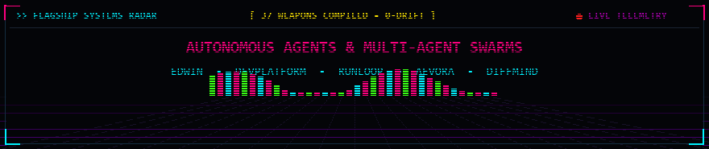

<!-- RETRO ARCADE LIVE RADAR ANIMATION -->

 

<!-- DYNAMIC TYPING TELEMETRY -->

---

## Autonomous Agents & Multi-Agent Swarms

| Project | Short Pitch | Tech Arsenal |
| :--- | :--- | :--- |
| 🕶️ **[EDWIN](https://github.com/ATLURI0001/EDWIN)** | Real-time autonomous vision & agentic swarm OSINT platform connecting smart-glasses biometrics to live dossier intelligence in seconds. | `Python` `FastAPI` `OpenCV` `Agent Swarms` `Vector Search` |
| 🧠⚙️ **[DevPlatform](https://github.com/ATLURI0001/DevPlatform)** | Engineering control plane for AI-native software delivery—orchestrating coding agents, ephemeral git worktrees, and self-healing CI pipelines. | `Go` `Kubernetes` `Docker` `TypeScript` `Next.js 15` |
| 🤖 **[Runloop](https://github.com/ATLURI0001/Runloop)** | Autonomous SWE agent that parses developer task prompts into executable coding, debugging, and self-correcting verification loops. | `Python` `LangGraph` `Docker` `AST Diffing` `PyTest` |
| 🌐 **[Aevora](https://github.com/ATLURI0001/Aevora)** | Autonomous web vision agent turning high-level natural language intent into verified multi-step browser actions across interactive web apps. | `TypeScript` `Playwright` `CDP` `Vision LLMs` `Node.js` |
| 🔍 **[DiffMind](https://github.com/ATLURI0001/DiffMind)** | AI-driven pull request intelligence providing automated architectural risk analysis, semantic diff indexing, and actionable reviews. | `Python` `Tree-Sitter` `GitHub API` `LLM Reasoning` |
| 🔥 **[GraphForge](https://github.com/ATLURI0001/GraphForge)** | Interactive playground and testing harness for architecting, visualizing, and checkpoint-debugging stateful multi-agent LangGraph workflows. | `Python` `LangGraph` `FastAPI` `React Flow` `TypeScript` |

---

## AI Evaluation, Safety & Zero-Drift Gates

| Project | Short Pitch | Tech Arsenal |
| :--- | :--- | :--- |
| 🛡️ **[Eval-Boundary-Controller](https://github.com/ATLURI0001/Eval-Boundary-Controller)** | Declarative evaluation boundary controller in Rust—enforcing predictive blast-radius selection, 95% Wilson confidence intervals, and zero-drift release gates. | `Rust` `Wilson 95% CI` `Statistical Inference` `Zero-Alloc` |
| 🎯 **[LLM-Hallucination-Detector](https://github.com/ATLURI0001/LLM-Hallucination-Detector)** | Sub-millisecond fact verification engine in Go—decomposing claims, grounding against source context, and detecting numeric distortions. | `Go` `Vector Embeddings` `NLI Grounding` `Goroutines` `gRPC` |
| ⚡ **[RAG-Attest](https://github.com/ATLURI0001/RAG-Attest)** | Ultra-fast Edge RAG evaluation & claim attestation engine powered by Zig (45,000+ evals/sec) and a custom RAG-L Domain-Specific Language. | `Zig` `RAG-L DSL` `Edge Computing` `SIMD` `Zero-Alloc` |
| ⚙️ **[EvalCore](https://github.com/ATLURI0001/EvalCore)** | Measurable quality engineering framework for LLMs—combining assertion-driven scoring, automated CI regression gates, and versioned eval tracking. | `Python` `PyTest Engine` `LLM Evals` `Statistical Scoring` |
| 🧪 **[PromptTestKit](https://github.com/ATLURI0001/PromptTestKit)** | Evaluation infrastructure for prompt evolution—versioned test suites, assertion-driven scoring, and granular regression gates for prompt changes. | `TypeScript` `Node.js` `Vitest` `Prompt Analytics` |
| 🔍 **[Model-Lens](https://github.com/ATLURI0001/Model-Lens)** | AI observability & distributed tracing platform tailored for LLMs and agentic swarms, capturing token burn, latency bottlenecks, and call hierarchies. | `Go` `OpenTelemetry` `ClickHouse` `Next.js 15` `Prometheus` |
| 🧠 **[Oriel](https://github.com/ATLURI0001/Oriel)** | High-performance semantic search and knowledge retrieval engine pairing hybrid dense/sparse vector search with cross-encoder reranking. | `Python` `FAISS` `FastAPI` `Transformers` `Redis` |

---

## Cloud Reliability, Kubernetes SRE & Control Planes

| Project | Short Pitch | Tech Arsenal |
| :--- | :--- | :--- |
| ☸️ **[target-reconciliation-service](https://github.com/ATLURI0001/target-reconciliation-service)** | Kubernetes-native reliability control plane orchestrating policy-driven reconciliation, automated workload recovery, and auditable infrastructure operations. | `Go 1.24+` `Kubernetes CRD` `controller-runtime` `PostgreSQL` |
| 🔒 **[mcp-authz-proxy](https://github.com/ATLURI0001/mcp-authz-proxy)** | Zero-trust authorization boundary for Model Context Protocol (MCP) tools—enforcing who can execute what, isolating credentials, and logging audit trails. | `Go` `Model Context Protocol` `OAuth2 / mTLS` `Zero-Trust` |
| 🚀 **[RouteKernel](https://github.com/ATLURI0001/RouteKernel)** | High-performance edge infrastructure for reverse proxying, TLS 1.3 termination, traffic shaping, weighted load balancing, and real-time observability. | `C++` `OpenSSL` `epoll` `Prometheus Metrics` |
| 🧭 **[Mcp-Server-Atlas](https://github.com/ATLURI0001/Mcp-Server-Atlas)** | Ecosystem directory and automated health monitoring engine tracking 591+ Model Context Protocol (MCP) servers across 21 categories. | `TypeScript` `Next.js 15` `GitHub API Crawler` `TailwindCSS` |
| 💸 **[Token-Tariff](https://github.com/ATLURI0001/Token-Tariff)** | Claude Code setup auditor estimating token spend from local trajectories and simulating cost-reduction strategies through caching and model tiering. | `Python` `Rich CLI` `Static Analysis` `Prompt Caching` |
| ☁️ **[Agentcore-Architecture-Harness](https://github.com/ATLURI0001/Agentcore-Architecture-Harness)** | Autonomous cloud architect agent on Amazon Bedrock AgentCore with Terraform, IAM-controlled MCP tools, and automated system diagramming. | `TypeScript` `Bedrock AgentCore` `Terraform` `AWS IAM` `MCP` |
| 🚦 **[Terraform-aws-ecs-blue-green](https://github.com/ATLURI0001/Terraform-aws-ecs-blue-green)** | Blue/green deployment pipeline for Amazon ECS with Terraform, canary traffic shifting, automated CloudWatch health alarms, and rollback CI/CD. | `Terraform` `AWS ECS` `AWS CodeDeploy` `CloudWatch` |
| 🏛️ **[Terraform-Org-Governance](https://github.com/ATLURI0001/Terraform-Org-Governance)** | Enterprise multi-account AWS Organizations governance framework managing OUs, SCP guardrails, Control Tower, and delegated administration for 14 services. | `Terraform` `AWS Organizations` `Control Tower` `IAM Identity Center` |
| 🖼️ **[Sagemaker-Vision-MLops](https://github.com/ATLURI0001/Sagemaker-Vision-MLops)** | Terraform-powered end-to-end MLOps pipeline for computer vision on Amazon SageMaker AI with distributed training and real-time feature drift alarms. | `Terraform` `Amazon SageMaker` `PyTorch` `Python` `AWS Lambda` |

---

## Bare-Metal Performance & High-Throughput Systems

| Project | Short Pitch | Tech Arsenal |
| :--- | :--- | :--- |
| ⚡ **[CoreMach9](https://github.com/ATLURI0001/CoreMach9)** | Bare-metal C++ HTTP performance lab built with Drogon and RapidJSON, pushing 250,000+ RPS to test native concurrency and memory throughput under saturation. | `C++20` `Drogon Framework` `RapidJSON` `epoll` `Linux Perf` |
| 💥 **[LoadMach9](https://github.com/ATLURI0001/LoadMach9)** | Extreme Node.js load benchmarking lab stress-testing Express, Fastify, and Cpeak with PostgreSQL tuning, Redis caching, and multicore cluster scaling. | `Node.js 22` `Fastify` `Express` `PostgreSQL` `Redis` `Autocannon` |
| 🏎️ **[FrameworkFaceoff](https://github.com/ATLURI0001/FrameworkFaceoff)** | Comparative benchmarking harness running 10+ web frameworks through identical workloads to measure RPS, p99.9 latency, CPU throttling, and memory footprint. | `Go` `Rust (Actix/Axum)` `Node.js` `Python (FastAPI)` `Docker` `k6` |

---

## Quantitative Protocols & Game Theory

| Project | Short Pitch | Tech Arsenal |
| :--- | :--- | :--- |
| 🪙 **[PioneerCrypto](https://github.com/ATLURI0001/PioneerCrypto)** | Decentralized rails for digital ownership, smart contract verification, gas-optimized ERC token standards, and high-integrity financial primitives. | `Solidity` `TypeScript` `Ethereum / EVM` `Hardhat` `Ethers.js` |
| 🎲 **[HouseScript](https://github.com/ATLURI0001/HouseScript)** | Transparent educational simulation demonstrating true mathematical casino odds, house edges, and negative expected value to help players step away from gambling. | `TypeScript` `React` `Chart.js` `Monte Carlo Simulators` |

---

## Computer Vision, Spatial OSINT & Real-Time Graphics

| Project | Short Pitch | Tech Arsenal |
| :--- | :--- | :--- |
| 🪞 **[NeuroMirror](https://github.com/ATLURI0001/NeuroMirror)** | Client-side 60 FPS WebGL anatomical & neural X-ray mirror tracking 478 face and 21 hand landmarks in WebAssembly with dynamic TMJ jaw kinematics. | `Three.js` `MediaPipe Tasks Vision` `GLSL Shaders` `WebAssembly` |
| 🏡 **[BuildSite](https://github.com/ATLURI0001/BuildSite)** | Turns verified developer commits into an evolving, photorealistic architectural villa inside GitHub READMEs using Blender PBR and vector compositing. | `Python 3.10+` `Blender 4.x PBR` `SVG Compositor` `GitHub Actions` |
| 🌐 **[Synoptic](https://github.com/ATLURI0001/Synoptic)** | Real-time geospatial intelligence platform for tracking global entity movement, satellite trajectories, and live 3D spatial telemetry in CesiumJS. | `JavaScript` `CesiumJS` `WebGL` `WebSockets` `Spatial Telemetry` |
| 🌍 **[Orbiscope](https://github.com/ATLURI0001/Orbiscope)** | Computational image geolocation intelligence combining visual cues, sun angles, shadow geometry, terrain elevation profiles, and open GIS data. | `Python` `OpenCV` `PyTorch` `GIS / GDAL` `Solar Ephemeris` |
| 🗺️ **[StrataGlyph](https://github.com/ATLURI0001/StrataGlyph)** | Declarative cloud architecture engine translating concise YAML specifications into animated diagrams with SVG, Draw.io, PNG, and React exports. | `TypeScript` `Vector Graphics` `Model Context Protocol` `Draw.io` |
| ✨ **[SnapVanish](https://github.com/ATLURI0001/SnapVanish)** | Real-time webcam disappearance effects powered by gesture triggers, background plate reconstruction, and direct virtual camera broadcasting. | `JavaScript` `TensorFlow.js` `MediaPipe Segmentation` `Canvas API` |
| 🚆 **[RailVani](https://github.com/ATLURI0001/RailVani)** | Indian Railways public address simulator featuring trilingual voice concatenation, authentic chimes, and an amber LED dot-matrix display. | `TypeScript` `Web Audio API` `HTML5 Canvas LED Engine` `Next.js` |
| 🎓 **[LMS](https://github.com/ATLURI0001/LMS)** | Multi-stack Learning Management System (85+ Stars) built across Python, Java Spring Boot, and MERN with role-based access control and Docker deployment. | `React` `Node.js` `Java Spring Boot` `Python` `PostgreSQL` |
| 📍 **[BizAtlas](https://github.com/ATLURI0001/BizAtlas)** | Automated data extraction engine discovering, validating, and collecting local business telemetry from mapping services via polygon segmentation. | `Python` `Playwright` `Pandas` `GeoPandas` `BeautifulSoup` |
| 🚗 **[BackSeat](https://github.com/ATLURI0001/BackSeat)** | Advanced driver assistance system (ADAS) integrating monocular lane curve fitting, obstacle distance tracking, and closed-loop vehicle control. | `Python` `OpenCV` `YOLOv8` `PyTorch` `CARLA Simulator` |

---

  <a href="https://github.com/ATLURI0001">GitHub Profile</a> &bull; <a href="https://ramprasadatluri.dev">Portfolio</a>

