<div align="center">

<!-- TOP VISUAL BANNER -->


<br/>

<!-- RETRO ARCADE ANIMATED HEADLINE -->
<a href="https://ramprasadatluri.dev">
  
</a>

<p align="center">
  
  
  
  
</p>

<!-- RETRO ARCADE HUD BOX -->
```
╔═══════════════════════════════════════════════════════════════════════════════════════════════════════════╗
║  🕹️ [1-UP] PILOT: RAM PRASAD ATLURI       STAGE: PRODUCTION-99        STATUS: [SYSTEMS OPERATIONAL]      ║
║  ❤️ HEALTH : [████████████████████] 100%     ⚡ MANA  : [████████████████████] OVERCLOCKED               ║
║  🏆 SCORE  : 9.02 CGPA (KLU DISTINCTION)   🎮 CLASS : DEVOPS / KUBERNETES SRE / QUANT & SYSTEMS ENG      ║
║  ⚔️ QUEST  : ELIMINATE DRIFT • AUTOMATE EVERYTHING • HARNESS BARE-METAL & MULTI-AGENT SWARMS             ║
╚═══════════════════════════════════════════════════════════════════════════════════════════════════════════╝
```

<!-- QUICK NAVIGATION MATRIX -->
<p align="center">
  <a href="#-flagship-projects-arcade-matrix"></a>
  <a href="#-career-battle-history--stages"></a>
  <a href="#-verified-trophies--credentials"></a>
  <a href="#-technical-arsenal--weaponry"></a>
  <a href="#-arcade-leaderboard--telemetry"></a>
  <a href="#-insert-coin-to-connect"></a>
</p>

<!-- PHILOSOPHY / LORE -->
<blockquote align="center">
  <i>"Martingale in a world with memory. Fair game, unfair clock."</i><br/>
  <b>Deterministic Resilience &bull; Sub-Millisecond AI Attestation &bull; Zero-Downtime Autonomous Clouds</b>
</blockquote>

<p align="center">
  <a href="https://ramprasadatluri.dev"></a>
  <a href="mailto:root@ramprasadatluri.dev"></a>
  <a href="https://github.com/ATLURI0001"></a>
  <a href="https://linkedin.com"></a>
</p>

</div>

---

## 🕹️ Flagship Projects: Arcade Matrix

<div align="center">
  <h3>⚡ 37+ PRODUCTION-GRADE WEAPONS // ZERO FLUFF // RAW ARCHITECTURE ⚡</h3>
  <p><i>From autonomous multi-agent intelligence and sub-millisecond AI evaluators to bare-metal HTTP labs, Kubernetes control planes, and real-time GPU graphics.</i></p>
</div>

```
┌───────────────────────────────────────────────────────────────────────────────────────────────────────────┐
│  MISSION INDEX: SELECT YOUR SECTOR                                                                        │
│  ├── [SECTOR 01] AUTONOMOUS AGENTS & MULTI-AGENT SWARMS (EDWIN, DevPlatform, Runloop, Aevora...)          │
│  ├── [SECTOR 02] AI EVALUATION, SAFETY & ZERO-DRIFT GATES (Eval-Boundary-Controller, RAG-Attest...)      │
│  ├── [SECTOR 03] CLOUD RELIABILITY, K8S SRE & DISTRIBUTED ENGINES (target-reconciliation-service...)     │
│  ├── [SECTOR 04] BARE-METAL PERFORMANCE & HIGH-THROUGHPUT LABS (CoreMach9, LoadMach9...)                 │
│  ├── [SECTOR 05] QUANT PROTOCOLS & RESPONSIBLE GAME THEORY (PioneerCrypto, HouseScript...)                │
│  └── [SECTOR 06] COMPUTER VISION, SPATIAL OSINT & REAL-TIME GRAPHICS (NeuroMirror, BuildSite, Synoptic...)│
└───────────────────────────────────────────────────────────────────────────────────────────────────────────┘
```

---

### 👾 SECTOR 01 // AUTONOMOUS AGENTS & MULTI-AGENT SWARMS
> *Synthesizing self-directed agent swarms, browser automation, and cognitive developer workflows.*

```
[SYSTEM ALERT] :: AGENT SWARM DEPLOYED • MULTI-MODAL REASONING • EVENT LOOPS ARMED
```

#### 1. 🕶️ [EDWIN](https://github.com/ATLURI0001/EDWIN) &nbsp; <kbd>AUTONOMOUS OSINT</kbd> &nbsp; <kbd>SWARM INTELLIGENCE</kbd>
> **The Pitch:** Real-time autonomous vision & agentic swarm OSINT platform turning wearable smart-glasses video into actionable dossier intelligence in seconds.
- **Architectural Highlights:**
  - Streams POV video feeds into a low-latency edge pipeline, extracting biometric face embeddings with client-side feature alignment.
  - Spawns asynchronous multi-agent research swarms that fan out across open-source web graphs, correlating social footprints, publications, and professional histories.
  - Generates unified, cited intelligence dossiers delivered to an augmented-reality HUD in under 5 seconds.
- **Arsenal:** `Python` &bull; `FastAPI` &bull; `Computer Vision` &bull; `Agent Swarms` &bull; `Vector Search` &bull; `WebSockets` &bull; `OpenCV`

#### 2. 🧠⚙️ [DevPlatform](https://github.com/ATLURI0001/DevPlatform) &nbsp; <kbd>CONTROL PLANE</kbd> &nbsp; <kbd>AI-NATIVE SDLC</kbd>
> **The Pitch:** The engineering control plane for AI-native software delivery—orchestrating coding agents, ephemeral worktrees, and self-healing CI pipelines.
- **Architectural Highlights:**
  - Manages concurrent coding agent lifecycles with deterministic sandboxes and automated worktree branching.
  - Integrates policy-driven regression guards, automatically rolling back failing test mutations and synthesizing corrective fixes.
  - Real-time event bus capturing step-by-step agent decisions with auditable trajectory logs and token accounting.
- **Arsenal:** `Go` &bull; `Kubernetes` &bull; `Docker Engine` &bull; `TypeScript` &bull; `Next.js 15` &bull; `gRPC` &bull; `TailwindCSS`

#### 3. 🤖 [Runloop](https://github.com/ATLURI0001/Runloop) &nbsp; <kbd>AUTONOMOUS SWE</kbd> &nbsp; <kbd>EXECUTABLE WORKFLOWS</kbd>
> **The Pitch:** Autonomous software engineering agent that parses complex developer task prompts and executes full-cycle coding, debugging, and verification loops.
- **Architectural Highlights:**
  - Autonomous AST code inspection, multi-file dependency graph resolution, and deterministic test synthesis.
  - Runs in sandboxed Docker execution environments with live stream capture of compilation errors and stack traces.
  - Self-healing retry loops that dynamically iterate on failing unit tests until zero regressions remain.
- **Arsenal:** `Python` &bull; `LangGraph` &bull; `Docker API` &bull; `AST Diffing` &bull; `Git Automation` &bull; `PyTest`

#### 4. 🌐 [Aevora](https://github.com/ATLURI0001/Aevora) &nbsp; <kbd>AUTONOMOUS WEB</kbd> &nbsp; <kbd>VISION AGENT</kbd>
> **The Pitch:** Turning high-level natural language intent into autonomous, verifiable browser actions across complex interactive web apps.

<p align="center">
  
</p>

- **Architectural Highlights:**
  - Vision-augmented DOM parsing that pairs pixel coordinates with accessibility trees to interact with zero-brittle selectors.
  - Resilient workflow execution across dynamic Single Page Apps (SPAs), multi-factor flows, and dynamic client-rendered frames.
  - Emits cryptographically verified action receipts detailing step screenshots, network requests, and target outcomes.
- **Arsenal:** `TypeScript` &bull; `Playwright` &bull; `Chrome DevTools Protocol (CDP)` &bull; `Vision LLMs` &bull; `Node.js`

#### 5. 🔍 [DiffMind](https://github.com/ATLURI0001/DiffMind) &nbsp; <kbd>AI PR AUDITOR</kbd> &nbsp; <kbd>CODE INTELLIGENCE</kbd>
> **The Pitch:** AI-driven pull request intelligence engine providing automated architectural risk analysis, semantic diff indexing, and actionable engineering reviews.
- **Architectural Highlights:**
  - Deep semantic tree-sitter AST diffing that categorizes changes into breaking API mutations, security risks, and optimization wins.
  - Blast-radius prediction calculating downstream caller risks before merging code into main branches.
  - Direct GitHub Actions bot integration posting inline, actionable line-level review comments.
- **Arsenal:** `Python` &bull; `Tree-Sitter` &bull; `GitHub API` &bull; `LLM Reasoning` &bull; `Static Analysis`

#### 6. 🔥 [GraphForge](https://github.com/ATLURI0001/GraphForge) &nbsp; <kbd>LANGGRAPH LAB</kbd> &nbsp; <kbd>STATEFUL WORKFLOWS</kbd>
> **The Pitch:** Interactive playground and harness for architecting, visualizing, and mastering stateful multi-agent workflows using LangGraph.

<p align="center">
  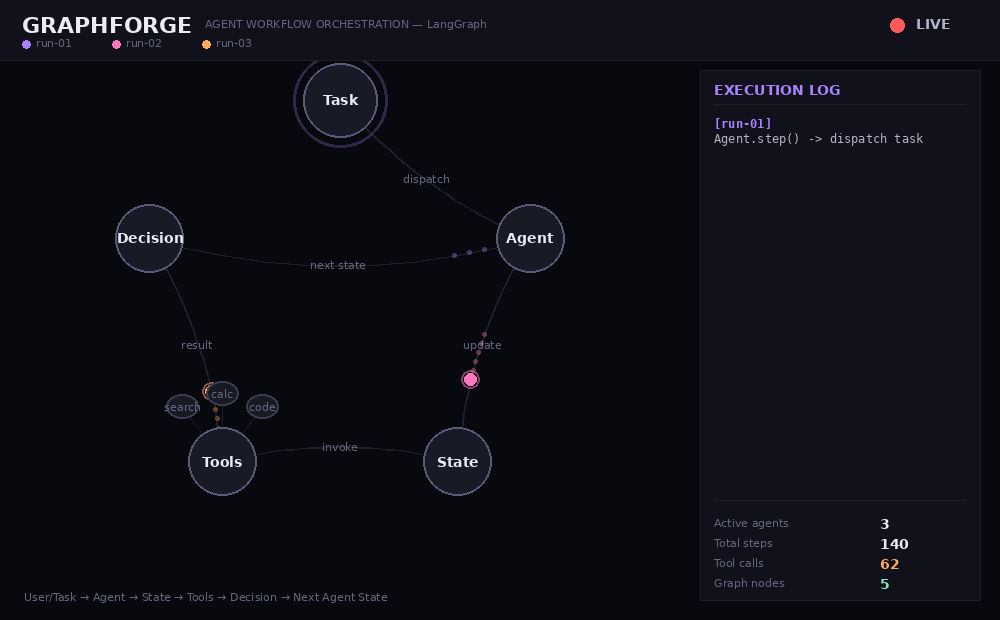
</p>

- **Architectural Highlights:**
  - Interactive DAG visualizer displaying real-time agent state mutations, node transitions, and cyclic branches.
  - Checkpoint rewind engine allowing engineers to pause execution, modify agent state in-flight, and branch alternative futures.
  - Benchmarks execution latency across parallel tool branches and validates cyclical termination conditions.
- **Arsenal:** `Python` &bull; `LangGraph` &bull; `FastAPI` &bull; `React Flow` &bull; `TypeScript` &bull; `WebSocket Engine`

---

### 🛡️ SECTOR 02 // AI EVALUATION, SAFETY & ZERO-DRIFT GATES
> *Deterministic release gates, sub-millisecond fact verification, and edge attestation engines.*

```
[SYSTEM ALERT] :: 45K+ EVALS/SEC • 95% WILSON CONFIDENCE • ZERO HALLUCINATION TOLERANCE
```

#### 7. 🛡️ [Eval-Boundary-Controller](https://github.com/ATLURI0001/Eval-Boundary-Controller) &nbsp; <kbd>RUST</kbd> &nbsp; <kbd>WILSON 95% CI</kbd> &nbsp; <kbd>ZERO DRIFT</kbd>
> **The Pitch:** Declarative evaluation boundary controller written in Rust—enforcing predictive blast-radius selection, 95% Wilson confidence intervals, and zero-drift release gates for AI pipelines.
- **Architectural Highlights:**
  - Sub-millisecond evaluation gatekeeper preventing stochastic model updates from breaking production invariants.
  - Statistical sampling engine computing Wilson score confidence intervals to mathematically bound evaluation uncertainty.
  - Dynamic blast-radius throttling that automatically restricts rollout percentages upon detecting semantic drift.
- **Arsenal:** `Rust` &bull; `Statistical Inference` &bull; `Wilson Score Intervals` &bull; `CI/CD Gates` &bull; `Zero-Alloc Engine`

#### 8. 🎯 [LLM-Hallucination-Detector](https://github.com/ATLURI0001/LLM-Hallucination-Detector) &nbsp; <kbd>SUB-MS GO ENGINE</kbd> &nbsp; <kbd>CLAIM DECOMPOSITION</kbd>
> **The Pitch:** High-precision, sub-millisecond LLM hallucination and fact-verification engine in Go—decomposing claims, grounding against source context, and detecting numeric distortions.
- **Architectural Highlights:**
  - Atomic claim decomposition breaking complex streaming model outputs into verifiable micro-assertions.
  - Sub-5ms grounding engine cross-referencing claims against source documentation using high-concurrency Goroutines.
  - Specialized heuristic validators detecting subtle numeric hallucinations, entity swapping, and negation inversions.
- **Arsenal:** `Go` &bull; `Vector Embeddings` &bull; `NLI Grounding` &bull; `High-Concurrency Goroutines` &bull; `gRPC`

#### 9. ⚡ [RAG-Attest](https://github.com/ATLURI0001/RAG-Attest) &nbsp; <kbd>ZIG 45K+ EVALS/S</kbd> &nbsp; <kbd>EDGE ATTESTATION</kbd> &nbsp; <kbd>RAG-L DSL</kbd>
> **The Pitch:** Ultra-fast, zero-cloud Edge RAG evaluation & claim attestation engine powered by Zig (45,000+ evals/sec) and a custom RAG-L Domain-Specific Language.
- **Architectural Highlights:**
  - Handcrafted Zig engine compiling down to a tiny native binary with zero runtime dependencies and zero garbage collection pauses.
  - Custom RAG-L domain-specific language for authoring high-throughput semantic assertion rules at network edge gateways.
  - Capable of validating context relevancy, groundedness, and answer completeness at 45k+ evaluations per second.
- **Arsenal:** `Zig` &bull; `RAG-L DSL` &bull; `Edge Computing` &bull; `SIMD Instructions` &bull; `Zero-Alloc Architecture`

#### 10. ⚙️ [EvalCore](https://github.com/ATLURI0001/EvalCore) &nbsp; <kbd>QUALITY ENGINEERING</kbd> &nbsp; <kbd>ASSERTION SCORING</kbd>
> **The Pitch:** Engineering measurable quality for LLM applications through evaluation, assertion-driven scoring, and continuous regression gates.

<p align="center">
  
</p>

- **Architectural Highlights:**
  - Comprehensive testing suite quantifying model hallucination, semantic drift, rubric compliance, and latency metrics.
  - Automated CI regression gates blocking non-deterministic model regressions before landing in production.
  - Granular test suites, automated failure trace analysis, and versioned evaluation leaderboards.
- **Arsenal:** `Python` &bull; `PyTest Engine` &bull; `LLM Evals` &bull; `Statistical Scoring` &bull; `CI/CD Automation`

#### 11. 🧪 [PromptTestKit](https://github.com/ATLURI0001/PromptTestKit) &nbsp; <kbd>PROMPT EVOLUTION</kbd> &nbsp; <kbd>REGRESSION GATES</kbd>
> **The Pitch:** Evaluation infrastructure for prompt evolution—versioned test suites, assertion-driven scoring, and granular regression gates that turn behavioral updates into auditable release decisions.
- **Architectural Highlights:**
  - Unit test framework for prompt engineers with declarative input/output assertion matrices and semantic fuzzy matchers.
  - Token spend and latency drift calculators evaluating cost implications before deploying prompt revisions.
  - Detailed regression diff viewer isolating behavioral shifts across model versions (e.g., Claude 3.5 Sonnet to GPT-4o).
- **Arsenal:** `TypeScript` &bull; `Node.js` &bull; `Vitest` &bull; `Prompt Engineering` &bull; `Token Drift Analytics`

#### 12. 🔍 [Model-Lens](https://github.com/ATLURI0001/Model-Lens) &nbsp; <kbd>AI OBSERVABILITY</kbd> &nbsp; <kbd>TOKEN TRACING</kbd>
> **The Pitch:** AI observability & distributed tracing platform tailored for LLMs and agentic swarms, capturing token burn, latency bottlenecks, and call hierarchies.
- **Architectural Highlights:**
  - OpenTelemetry-native trace propagation tracking nested agent tool calls, streaming spans, and model roundtrips.
  - Real-time token economics dashboard breaking down spend across users, sessions, prompt caches, and model providers.
  - Streaming Time-to-First-Token (TTFT) and throughput (tokens/sec) monitoring with automated anomaly alarms.
- **Arsenal:** `Go` &bull; `OpenTelemetry` &bull; `ClickHouse` &bull; `Next.js 15` &bull; `Prometheus`

#### 13. 🧠 [Oriel](https://github.com/ATLURI0001/Oriel) &nbsp; <kbd>SEMANTIC SEARCH</kbd> &nbsp; <kbd>HYBRID RETRIEVAL</kbd>
> **The Pitch:** High-performance semantic search and knowledge retrieval engine built specifically for AI architectures and retrieval-augmented generation.

<p align="center">
  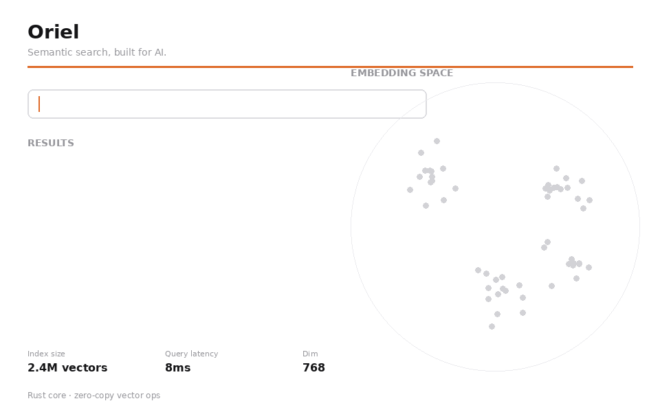
</p>

- **Architectural Highlights:**
  - Hybrid dense vector and BM25 sparse keyword retrieval with reciprocal rank fusion (RRF) for maximized recall.
  - Integrated cross-encoder reranking stage delivering sub-10ms query responses under concurrent load.
  - Automated text chunking with semantic boundary detection preserving context across document ingestion pipelines.
- **Arsenal:** `Python` &bull; `FAISS` &bull; `FastAPI` &bull; `HuggingFace Transformers` &bull; `Redis`

---

### ☸️ SECTOR 03 // CLOUD RELIABILITY, K8S SRE & DISTRIBUTED ENGINES
> *Self-healing Kubernetes control planes, zero-trust MCP boundaries, and enterprise multi-account governance.*

```
[SYSTEM ALERT] :: KUBERNETES RECONCILIATION ARMED • 0-DOWNTIME ROLLOUTS • ZERO-TRUST BOUNDARIES
```

#### 14. ☸️ [target-reconciliation-service](https://github.com/ATLURI0001/target-reconciliation-service) &nbsp; <kbd>K8S CRD</kbd> &nbsp; <kbd>SELF-HEALING SRE</kbd>
> **The Pitch:** Kubernetes-native reliability control plane orchestrating policy-driven reconciliation, automated workload recovery, failure remediation, and auditable infrastructure operations.

<p align="center">
  
</p>

- **Architectural Highlights:**
  - Custom `ReliabilityTarget` CRD in Go orchestrating automated crashLoopBackoff healing and deterministic rollbacks.
  - PostgreSQL-backed transactional event timeline with immutable audit guarantees and zero in-memory fallback.
  - Production Next.js operator console, Prometheus metrics exporter, and Kind integration test harness.
- **Arsenal:** `Go 1.24+` &bull; `Kubernetes CRD` &bull; `controller-runtime` &bull; `PostgreSQL` &bull; `Next.js` &bull; `Prometheus` &bull; `Grafana`

#### 15. 🔒 [mcp-authz-proxy](https://github.com/ATLURI0001/mcp-authz-proxy) &nbsp; <kbd>MCP BOUNDARY</kbd> &nbsp; <kbd>ZERO-TRUST GO</kbd>
> **The Pitch:** An authorization boundary for Model Context Protocol (MCP) tools—built in Go to enforce who can execute what, isolate credentials, and make every approved action traceable.
- **Architectural Highlights:**
  - Sits between AI agents and local/remote MCP servers, intercepting JSON-RPC calls and enforcing granular RBAC policies.
  - Injects API keys and tokens transparently so sensitive credentials never leak into LLM system prompts or memory.
  - Configurable human-in-the-loop approval triggers for high-blast-radius commands (e.g., shell executions or database writes).
- **Arsenal:** `Go` &bull; `Model Context Protocol (MCP)` &bull; `OAuth2 / mTLS` &bull; `Zero-Trust` &bull; `JSON-RPC`

#### 16. 🚀 [RouteKernel](https://github.com/ATLURI0001/RouteKernel) &nbsp; <kbd>EDGE INFRASTRUCTURE</kbd> &nbsp; <kbd>TLS 1.3 / EPOLL</kbd>
> **The Pitch:** High-performance edge infrastructure for reverse proxying, TLS termination, load balancing, traffic control, and real-time observability.
- **Architectural Highlights:**
  - Asynchronous event-driven network core powered by Linux `epoll` handling tens of thousands of idle connections with minimal memory.
  - Zero-downtime hot certificate reload, automated ACME challenge solving, and weighted round-robin backend health probes.
  - Integrated leaky-bucket rate limiting and live Prometheus metric counters for edge telemetry.
- **Arsenal:** `C++` &bull; `OpenSSL` &bull; `epoll` &bull; `Prometheus Metrics` &bull; `High-Throughput Networking`

#### 17. 🧭 [Mcp-Server-Atlas](https://github.com/ATLURI0001/Mcp-Server-Atlas) &nbsp; <kbd>MCP ATLAS</kbd> &nbsp; <kbd>591+ SERVERS</kbd>
> **The Pitch:** Explore 591 Model Context Protocol (MCP) servers across 21 categories. Filter by category or language with automated submission checks and link monitoring.
- **Architectural Highlights:**
  - Automated GitHub Actions crawler continuously validating upstream repository health, release tags, and schema compliance.
  - Multi-faceted categorization engine classifying servers across databases, dev tools, cloud providers, and AI platforms.
  - Full-text search and client-side filtering allowing AI engineers to locate MCP tooling instantly.
- **Arsenal:** `TypeScript` &bull; `Next.js 15` &bull; `GitHub API Crawler` &bull; `TailwindCSS` &bull; `Automation`

#### 18. 💸 [Token-Tariff](https://github.com/ATLURI0001/Token-Tariff) &nbsp; <kbd>TOKEN AUDITOR</kbd> &nbsp; <kbd>COST ARBITRAGE</kbd>
> **The Pitch:** Audit your Claude Code setup, estimate token spend from local usage trajectories, and see which model, caching, and configuration changes reduce costs.

<p align="center">
  
</p>

- **Architectural Highlights:**
  - Parses local developer agent conversation histories, calculating prompt cache hit rates and context window inflation.
  - Simulates cost models comparing Sonnet vs Haiku substitutions and identifies prompt caching break-even points.
  - Generates rich CLI terminal summaries and actionable markdown audit reports for engineering cost governance.
- **Arsenal:** `Python` &bull; `Rich CLI` &bull; `Static Analysis` &bull; `Prompt Caching Modeling`

#### 19. ☁️ [Agentcore-Architecture-Harness](https://github.com/ATLURI0001/Agentcore-Architecture-Harness) &nbsp; <kbd>AWS BEDROCK</kbd> &nbsp; <kbd>TERRAFORM ARCHITECT</kbd>
> **The Pitch:** Deploy an AWS architecture agent on Amazon Bedrock AgentCore with Terraform, IAM-controlled MCP tools, architecture diagrams, and design document generation.

<p align="center">
  
</p>

- **Architectural Highlights:**
  - Production agent runtime integrating Bedrock foundation models with scoped MCP tool execution for cloud architecture modeling.
  - Automated generation of Well-Architected AWS topologies, Terraform modules, and cost estimates.
  - Strict IAM authorization boundaries and credential isolation preventing privilege escalation during tool invocations.
- **Arsenal:** `TypeScript` &bull; `Amazon Bedrock AgentCore` &bull; `Terraform` &bull; `AWS IAM` &bull; `MCP`

#### 20. 🚦 [Terraform-aws-ecs-blue-green](https://github.com/ATLURI0001/Terraform-aws-ecs-blue-green) &nbsp; <kbd>ZERO-DOWNTIME</kbd> &nbsp; <kbd>AWS ECS</kbd>
> **The Pitch:** Blue/green deployments for Amazon ECS with Terraform, canary traffic shifting, health-alarm rollback, and CI/CD across dev, test, and production.
- **Architectural Highlights:**
  - AWS CodeDeploy integration with linear and canary traffic routing strategies for zero-downtime container deployments.
  - CloudWatch metric alarm triggers that automatically abort and revert traffic upon error rate spikes.
  - Modular Terraform codebase supporting multi-environment promotion from development to production.
- **Arsenal:** `Terraform` &bull; `AWS ECS (Fargate)` &bull; `AWS CodeDeploy` &bull; `CloudWatch Alarms` &bull; `GitHub Actions`

#### 21. 🏛️ [Terraform-Org-Governance](https://github.com/ATLURI0001/Terraform-Org-Governance) &nbsp; <kbd>AWS ORG GOVERNANCE</kbd> &nbsp; <kbd>CONTROL TOWER</kbd>
> **The Pitch:** Govern AWS Organizations with Terraform. Manage organizational units, six policy types, AWS Control Tower controls, and delegated administration for 14 AWS services.
- **Architectural Highlights:**
  - Declarative management of Organizational Units (OUs), Service Control Policies (SCPs), and Resource Control Policies (RCPs).
  - Enforces mandatory guardrails, backup policies, tag policies, and centralized security hub logging.
  - Configures delegated administrator accounts for IAM Identity Center, GuardDuty, Macie, and Security Hub.
- **Arsenal:** `Terraform` &bull; `AWS Organizations` &bull; `AWS Control Tower` &bull; `IAM Identity Center` &bull; `Security Hub`

#### 22. 🖼️ [Sagemaker-Vision-MLops](https://github.com/ATLURI0001/Sagemaker-Vision-MLops) &nbsp; <kbd>TERRAFORM MLOPS</kbd> &nbsp; <kbd>SAGEMAKER</kbd>
> **The Pitch:** Terraform-powered MLOps for binary image classification on Amazon SageMaker AI, with parallel model training, quality checks, endpoint deployment, and drift monitoring.
- **Architectural Highlights:**
  - Automated training pipeline execution with hyperparameter optimization and model registry versioning.
  - Real-time SageMaker endpoint provisioning with canary traffic splitting and auto-scaling policies.
  - Automated data capture with SageMaker Model Monitor evaluating feature drift and prediction quality.
- **Arsenal:** `Terraform` &bull; `Amazon SageMaker` &bull; `Python` &bull; `PyTorch` &bull; `AWS Lambda` &bull; `S3`

---

### ⚡ SECTOR 04 // BARE-METAL PERFORMANCE & HIGH-THROUGHPUT LABS
> *Benchmarking C++ Drogon, RapidJSON, multicore Node.js, and saturation load testing.*

```
[SYSTEM ALERT] :: DROGON C++ 250K+ RPS • RAPIDJSON HARDWARE CONCURRENCY • ZERO GC OVERHEAD
```

#### 23. ⚡ [CoreMach9](https://github.com/ATLURI0001/CoreMach9) &nbsp; <kbd>C++20 DROGON</kbd> &nbsp; <kbd>RAPIDJSON</kbd> &nbsp; <kbd>BARE-METAL</kbd>
> **The Pitch:** CoreMach9 puts every core to work. A C++ HTTP performance lab built with Drogon and RapidJSON to explore how native concurrency and JSON processing shape throughput and latency under load.
- **Architectural Highlights:**
  - Harnesses Drogon's non-blocking I/O event loops and epoll multiplexing to achieve over 250,000 requests per second.
  - Compares DOM vs SAX parsing modes in RapidJSON with memory alignment optimizations and zero-copy string views.
  - Evaluates cache line alignment, thread pool affinity, and tail-latency behavior under severe connection saturation.
- **Arsenal:** `C++20` &bull; `Drogon Framework` &bull; `RapidJSON` &bull; `epoll` &bull; `Linux Perf` &bull; `Flamegraphs`

#### 24. 💥 [LoadMach9](https://github.com/ATLURI0001/LoadMach9) &nbsp; <kbd>NODE.JS EXTREME</kbd> &nbsp; <kbd>FASTIFY VS EXPRESS</kbd>
> **The Pitch:** Push Node.js to its limits. Benchmark requests/sec, latency, and error rates across Express, Fastify, and Cpeak. Explore PostgreSQL tuning, Redis acceleration, and multicore scaling.
- **Architectural Highlights:**
  - Head-to-head benchmarking across web frameworks under 100k concurrent client loads using Autocannon and k6.
  - PostgreSQL connection pool stress testing, index tuning, and Redis read-through cache optimization.
  - Profiles Node.js cluster module performance vs single-core throughput, isolating V8 garbage collection pause times.
- **Arsenal:** `Node.js (v22+)` &bull; `Fastify` &bull; `Express` &bull; `PostgreSQL` &bull; `Redis` &bull; `Autocannon`

#### 25. 🏎️ [FrameworkFaceoff](https://github.com/ATLURI0001/FrameworkFaceoff) &nbsp; <kbd>CROSS-RUNTIME</kbd> &nbsp; <kbd>HARDWARE BENCHMARK</kbd>
> **The Pitch:** A benchmarking platform running web frameworks through comparable workloads—from basic HTTP to JSON processing, database queries, gRPC, and WebSockets.
- **Architectural Highlights:**
  - Standardized workload harness ensuring exact parity in serialization, database querying, and payload size.
  - Captures real-time CPU throttling, memory footprint saturation, and p99.9 latency curves under scaling concurrency.
  - Produces reproducible telemetry graphs and automated comparative markdown matrices.
- **Arsenal:** `Go` &bull; `Rust (Actix/Axum)` &bull; `Node.js` &bull; `Python (FastAPI)` &bull; `Docker` &bull; `k6`

---

### 🪙 SECTOR 05 // QUANT PROTOCOLS & RESPONSIBLE GAME THEORY
> *Decentralized financial primitives, smart contracts, and transparent stochastic risk modeling.*

```
[SYSTEM ALERT] :: DETERMINISTIC REVENUE LOGIC • AUDITED CONTRACT RAILS • PROBABILISTIC MODELS
```

#### 26. 🪙 [PioneerCrypto](https://github.com/ATLURI0001/PioneerCrypto) &nbsp; <kbd>WEB3 RAILS</kbd> &nbsp; <kbd>SOLIDITY</kbd>
> **The Pitch:** Architecting decentralized rails for digital ownership, smart contract verification, and high-integrity financial primitives.

<p align="center">
  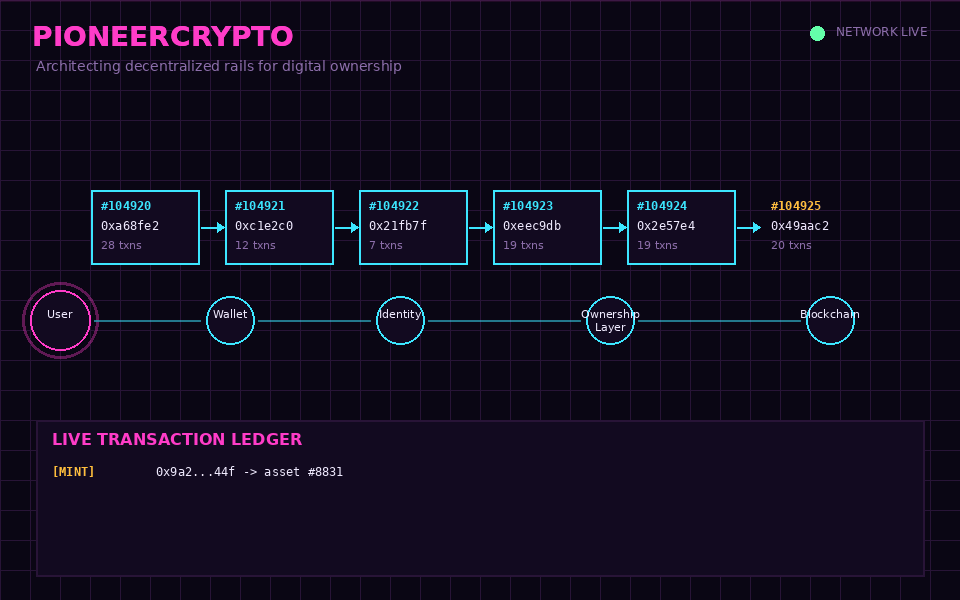
</p>

- **Architectural Highlights:**
  - Resilient smart contract architecture with audited ownership standards and tokenized asset management.
  - Web3 wallet interaction layers, deterministic state verification, and on-chain event listeners.
  - Explores cryptographic settlement mechanisms, gas-optimized ERC standards, and DeFi primitives.
- **Arsenal:** `TypeScript` &bull; `Web3` &bull; `Solidity` &bull; `Ethereum / EVM` &bull; `Hardhat` &bull; `Ethers.js`

#### 27. 🎲 [HouseScript](https://github.com/ATLURI0001/HouseScript) &nbsp; <kbd>RISK TRANSPARENCY</kbd> &nbsp; <kbd>MONTE CARLO</kbd>
> **The Pitch:** Step behind the bet. Explore gambling risks through fictional games, transparent odds, and clearly labelled scripted outcomes—built to encourage people to step away from gambling.
- **Architectural Highlights:**
  - Interactive simulator modeling negative expected value (-EV) and Monte Carlo ruin probabilities over long horizons.
  - Transparent visualizers exposing house mathematical edges, dynamic bankroll decay, and volatility traps.
  - Educational gamified environment designed with zero real-money integration to deconstruct cognitive fallacies.
- **Arsenal:** `TypeScript` &bull; `React` &bull; `Chart.js` &bull; `Monte Carlo Simulators` &bull; `Probability Modeling`

---

### 🪞 SECTOR 06 // COMPUTER VISION, SPATIAL OSINT & REAL-TIME GRAPHICS
> *Client-side 60 FPS WebGL, Blender PBR procedural generation, and global spatial telemetry.*

```
[SYSTEM ALERT] :: 60 FPS CLIENT WEBGL • PROCEDURAL VECTOR GRAPHICS • SATELLITE TELEMETRY
```

#### 28. 🪞 [NeuroMirror](https://github.com/ATLURI0001/NeuroMirror) &nbsp; <kbd>THREE.JS 60 FPS</kbd> &nbsp; <kbd>MEDIAPIPE</kbd> &nbsp; <kbd>GLSL SHADERS</kbd>
> **The Pitch:** Real-time webcam-driven anatomical visualization with interactive 60 FPS X-ray simulations of cranial, neural, and muscular structures.

<p align="center">
  
</p>

- **Architectural Highlights:**
  - Tracks 478 3D facial landmarks and 21 articulated hand joints completely client-side in WebAssembly with zero server lag.
  - Dynamic TMJ jaw kinematics: 3D mandible bone rotates synchronously around its anatomical hinge as you speak or yawn.
  - Custom GLSL holographic Fresnel X-ray shaders, interactive flashlight lens reveals, and real-time billboarded anatomical labels.
- **Arsenal:** `Three.js (WebGL 2.0)` &bull; `Google MediaPipe Tasks Vision` &bull; `GLSL Shaders` &bull; `WebAssembly` &bull; `JavaScript`

#### 29. 🏡 [BuildSite](https://github.com/ATLURI0001/BuildSite) &nbsp; <kbd>BLENDER PBR</kbd> &nbsp; <kbd>EVOLVING ESTATE</kbd>
> **The Pitch:** Your GitHub Builds Your Home. Turn verified commits into a photorealistic, evolving luxury villa inside your profile README.

<p align="center">
  
</p>

- **Architectural Highlights:**
  - Hybrid 2-stage graphics architecture: Blender physically based rendering combined with an ultra-fast (<200ms) vector compositor.
  - Deterministically transforms developer commits, PRs, and reviews into progressive architectural milestones (Foundations &rarr; Framing &rarr; Pool &rarr; Villa).
  - Generates self-contained, standards-compliant SVG documents with zero external dependencies or API fees.
- **Arsenal:** `Python 3.10+` &bull; `Blender 4.x PBR` &bull; `SVG Compositor` &bull; `GitHub Actions` &bull; `GraphQL API`

#### 30. 🌐 [Synoptic](https://github.com/ATLURI0001/Synoptic) &nbsp; <kbd>CESIUMJS 3D</kbd> &nbsp; <kbd>SPATIAL OSINT</kbd>
> **The Pitch:** Real-time geospatial intelligence platform for visualizing global activity, tracking satellite trajectories, and exploring live spatial telemetry.

<p align="center">
  
</p>

- **Architectural Highlights:**
  - High-frequency ingestion of global geospatial data feeds with real-time trajectory visualization and predictive pathing.
  - 3D planetary rendering with hardware-accelerated entity clustering and dynamic spatial heatmaps.
  - Mission-control dashboard displaying multi-source telemetry, altitude vectors, and situational intelligence.
- **Arsenal:** `JavaScript` &bull; `CesiumJS` &bull; `WebGL` &bull; `WebSockets` &bull; `Spatial Telemetry Engine`

#### 31. 🌍 [Orbiscope](https://github.com/ATLURI0001/Orbiscope) &nbsp; <kbd>GEO INFERENCE</kbd> &nbsp; <kbd>SOLAR EPHEMERIS</kbd>
> **The Pitch:** Infer where an image was captured by combining visual evidence, geographic data, terrain geometry, and computational reasoning.
- **Architectural Highlights:**
  - Multi-modal pipeline pairing image semantic features with global digital elevation models (DEM) and open GIS repositories.
  - Solar ephemeris shadow geometry calculations cross-referencing sun angles to narrow capture coordinates and timestamps.
  - Automated satellite view alignment verifying skyline contours against candidate coordinates.
- **Arsenal:** `Python` &bull; `OpenCV` &bull; `PyTorch` &bull; `GIS / GDAL` &bull; `Solar Ephemeris Models`

#### 32. 🗺️ [StrataGlyph](https://github.com/ATLURI0001/StrataGlyph) &nbsp; <kbd>YAML TO DIAGRAMS</kbd> &nbsp; <kbd>MCP EXPORT</kbd>
> **The Pitch:** Turn YAML into animated cloud architecture diagrams. Export SVG, PNG, draw.io, React, or HTML through the CLI or an MCP client.

<p align="center">
  
</p>

- **Architectural Highlights:**
  - Converts concise declarative YAML definitions into interactive, layered AWS/GCP/Kubernetes topology diagrams.
  - Multi-target export support: responsive SVGs, Draw.io XML schemas, PNG assets, and standalone React components.
  - Plugs natively into AI coding assistants via Model Context Protocol (MCP) for automated system design generation.
- **Arsenal:** `TypeScript` &bull; `Vector Graphics Engine` &bull; `Model Context Protocol (MCP)` &bull; `Draw.io Integration`

#### 33. ✨ [SnapVanish](https://github.com/ATLURI0001/SnapVanish) &nbsp; <kbd>REAL-TIME GESTURES</kbd> &nbsp; <kbd>VIRTUAL CAMERA</kbd>
> **The Pitch:** Real-time webcam disappearance effects powered by hand gestures, motion tracking, and virtual camera integration.
- **Architectural Highlights:**
  - Automated background plate reconstruction memorizing clean scenery behind the subject in real time.
  - Machine-learning gesture recognition triggering instantaneous cloaking and cloaking fade transitions.
  - Streams directly into OBS virtual camera loopback for native usage across Zoom, Google Meet, and Teams.
- **Arsenal:** `JavaScript` &bull; `TensorFlow.js` &bull; `MediaPipe Selfie Segmentation` &bull; `Canvas API` &bull; `WebRTC`

#### 34. 🚆 [RailVani](https://github.com/ATLURI0001/RailVani) &nbsp; <kbd>AUDIO ENGINE</kbd> &nbsp; <kbd>LED MATRIX</kbd>
> **The Pitch:** Authentic Indian Railways & Metro station public address (PA) announcement simulator with pre-recorded human voice broadcasts, retro LED dot-matrix display, and live dispatch telemetry.
- **Architectural Highlights:**
  - Trilingual concatenative voice synthesis system sequencing authentic Hindi, English, and regional dialect chimes.
  - Hardware-style amber LED dot-matrix visualizer rendered in real-time HTML5 Canvas with character persistence effects.
  - Dynamic timetable scheduler simulating platform changes, delays, and passenger express arrivals.
- **Arsenal:** `TypeScript` &bull; `Web Audio API` &bull; `HTML5 Canvas LED Engine` &bull; `Next.js` &bull; `TailwindCSS`

#### 35. 🎓 [LMS — Enterprise Academic Platform](https://github.com/ATLURI0001/LMS) &nbsp; <kbd>85+ STARS</kbd> &nbsp; <kbd>MULTI-STACK</kbd>
> **The Pitch:** A multi-stack Learning Management System built with Python, Java Spring Boot, and MERN, featuring modular architecture, academic workflows, and scalable full-stack development.

<p align="center">
  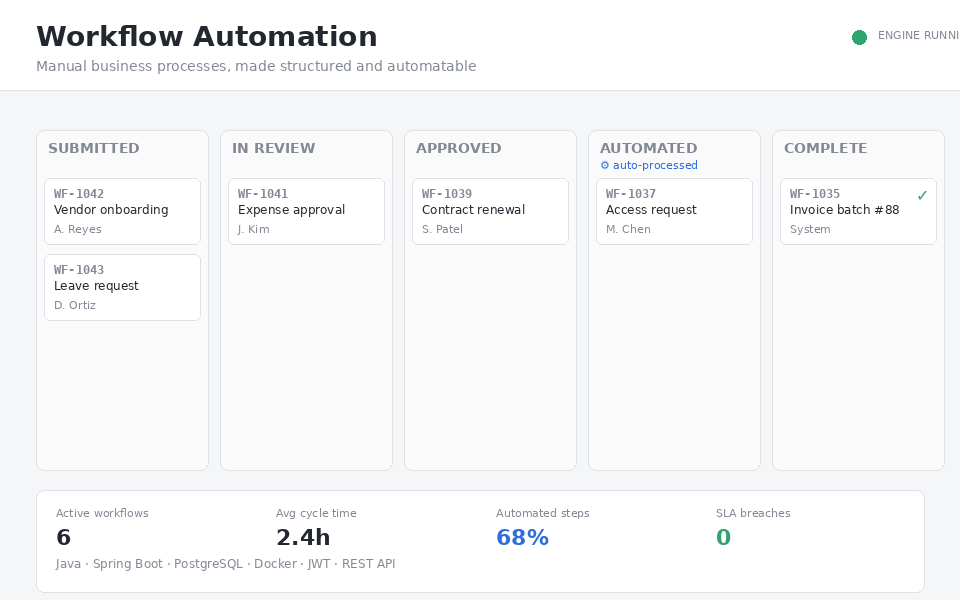
</p>

- **Architectural Highlights:**
  - 85+ GitHub Stars: Highly modular architecture supporting enterprise academic workflows and course management.
  - Role-based access control (RBAC), multi-tenant student/faculty portals, and automated assessment evaluation.
  - Containerized deployment with Docker and integrated microservice orchestration.
- **Arsenal:** `JavaScript (React / Node.js)` &bull; `Java (Spring Boot)` &bull; `Python` &bull; `PostgreSQL` &bull; `Docker`

#### 36. 📍 [BizAtlas](https://github.com/ATLURI0001/BizAtlas) &nbsp; <kbd>SPATIAL SCRAPING</kbd> &nbsp; <kbd>DATA PIPELINE</kbd>
> **The Pitch:** A tool for discovering and collecting local business data and spatial telemetry from map listings at scale.
- **Architectural Highlights:**
  - High-concurrency scraper featuring geo-polygon coordinate bounding box segmentation to maximize query density.
  - Automated data enrichment validating phone numbers, business hours, and operational status.
  - Clean tabular data exporter outputting to JSON, CSV, and PostgreSQL stores for downstream analysis.
- **Arsenal:** `Python` &bull; `Playwright` &bull; `Pandas` &bull; `GeoPandas` &bull; `BeautifulSoup`

#### 37. 🚗 [BackSeat](https://github.com/ATLURI0001/BackSeat) &nbsp; <kbd>ADAS</kbd> &nbsp; <kbd>VEHICLE VISION</kbd>
> **The Pitch:** An advanced driver assistance system (ADAS) integrating real-time road perception, lane keeping, adaptive cruise control, and intelligent vehicle automation.
- **Architectural Highlights:**
  - Monocular camera lane boundary detection fitting polynomial curves to curved highways under varied lighting.
  - Object detection and bounding box telemetry calculating lead-vehicle distance and time-to-collision (TTC).
  - Simulated vehicle actuation interfacing with CARLA simulator telemetry for closed-loop cruise control.
- **Arsenal:** `Python` &bull; `OpenCV` &bull; `YOLOv8` &bull; `PyTorch` &bull; `CARLA Simulator Integration`

---

## 💼 Career Battle History // Stages

<table width="100%">
  <thead>
    <tr>
      <th width="30%">Stage & Organization</th>
      <th width="20%">Duration & Deployment</th>
      <th width="50%">Key Engineering Milestones & Mission Log</th>
    </tr>
  </thead>
  <tbody>
    <tr>
      <td>
        <b>STAGE 05 // DEVOPS ENGINEER</b><br/>
        <sub>🏢 <b>SPIRE INFOTECH</b> &bull; Full-Time</sub>
      </td>
      <td>
        <code>Oct 2026 – Present</code><br/>
        <sub>📍 Hyderabad, India</sub>
      </td>
      <td>
        &bull; Driving cloud infrastructure operations, containerized workload scaling, and Kubernetes orchestration.<br/>
        &bull; Developing resilient CI/CD delivery pipelines, automated canary rollouts, and GitOps release practices.<br/>
        &bull; Standardizing Infrastructure as Code (IaC) via Terraform, policy-governed environments, and cluster reliability.
      </td>
    </tr>
    <tr>
      <td>
        <b>STAGE 04 // API INTEGRATION DEV</b><br/>
        <sub>🛸 <b>Hoppscotch</b> &bull; Contract</sub>
      </td>
      <td>
        <code>Sep 2025 – Apr 2026</code><br/>
        <sub>⏱️ 8 months</sub>
      </td>
      <td>
        &bull; Optimized API request/response lifecycles, streaming client protocols, and payload serialization.<br/>
        &bull; Implemented multi-protocol authentication mechanisms (OAuth2, Bearer tokens, mTLS) and validation suites.<br/>
        &bull; Enhanced cross-platform integration reliability under high concurrent request volumes.
      </td>
    </tr>
    <tr>
      <td>
        <b>STAGE 03 // CLOUD RELIABILITY ENG</b><br/>
        <sub>📡 <b>SigNoz</b> &bull; Internship</sub>
      </td>
      <td>
        <code>Mar 2025 – Jun 2025</code><br/>
        <sub>⏱️ 4 months</sub>
      </td>
      <td>
        &bull; Built and tuned cloud-native observability infrastructure powered by OpenTelemetry (OTel).<br/>
        &bull; Deployed high-throughput distributed tracing collectors, log aggregation pipelines, and metric stores.<br/>
        &bull; Automated cluster health monitors, alerting thresholds, and infrastructure failure detection workflows.
      </td>
    </tr>
    <tr>
      <td>
        <b>STAGE 02 // BACKEND ASSOCIATE</b><br/>
        <sub>🧪 <b>Keploy</b> &bull; Internship</sub>
      </td>
      <td>
        <code>Jul 2024 – Dec 2024</code><br/>
        <sub>⏱️ 6 months</sub>
      </td>
      <td>
        &bull; Engineered zero-code API test automation and deterministic mock recording engines for distributed microservices.<br/>
        &bull; Streamlined service-to-service dependency validation, regression gates, and CI integration pipelines.<br/>
        &bull; Accelerated troubleshooting workflows and reduced regression cycles across microservice clusters.
      </td>
    </tr>
    <tr>
      <td>
        <b>STAGE 01 // OPEN SOURCE UI DEV</b><br/>
        <sub>⚡ <b>ToolJet</b> &bull; Open Source</sub>
      </td>
      <td>
        <code>Jan 2024 – Jun 2024</code><br/>
        <sub>⏱️ 6 months</sub>
      </td>
      <td>
        &bull; Contributed core frontend modules in React and TypeScript for low-code internal application development.<br/>
        &bull; Optimized layout rendering engines, responsive state synchronization, and complex widget interactions.<br/>
        &bull; Resolved critical UI performance bottlenecks and enhanced cross-browser user experience.
      </td>
    </tr>
  </tbody>
</table>

---

## 📜 Verified Trophies & Credentials

<div align="center">

<table width="100%">
  <tr>
    <td align="center" width="25%">
      <a href="https://www.credly.com/badges/867b2a37-9623-4e0d-bd37-63f003c9350f">
        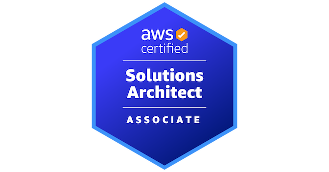
      </a><br/>
      <b>AWS Solutions Architect</b><br/>
      <sub>Associate &bull; Amazon Web Services</sub><br/>
      <code>ID: 867b2a37...</code><br/><br/>
      <a href="https://www.credly.com/badges/867b2a37-9623-4e0d-bd37-63f003c9350f">
        
      </a>
    </td>
    <td align="center" width="25%">
      <a href="https://www.credly.com/badges/566a1b33-7fb4-40a7-8434-2dc9ae396e50">
        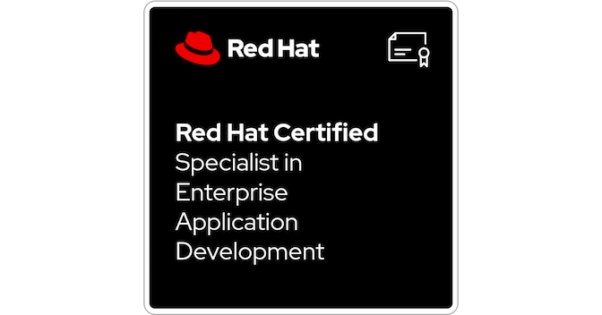
      </a><br/>
      <b>Red Hat Specialist</b><br/>
      <sub>Enterprise App Development</sub><br/>
      <code>ID: 566a1b33...</code><br/><br/>
      <a href="https://www.credly.com/badges/566a1b33-7fb4-40a7-8434-2dc9ae396e50">
        
      </a>
    </td>
    <td align="center" width="25%">
      <a href="https://www.credly.com/badges/6a0ef4d3-6178-45d3-8f69-d42a3fbe3563">
        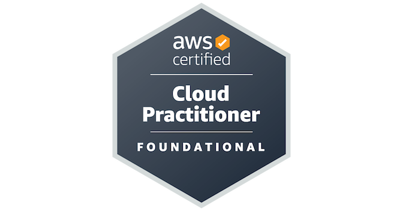
      </a><br/>
      <b>AWS Cloud Practitioner</b><br/>
      <sub>Foundational &bull; AWS</sub><br/>
      <code>ID: 6a0ef4d3...</code><br/><br/>
      <a href="https://www.credly.com/badges/6a0ef4d3-6178-45d3-8f69-d42a3fbe3563">
        
      </a>
    </td>
    <td align="center" width="25%">
      <a href="https://www.credly.com/badges/2476f521-9e70-416c-b468-781f3a8a39b7">
        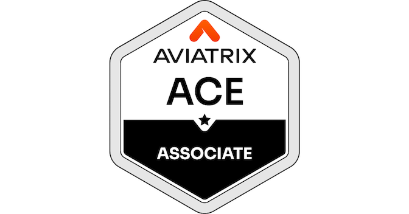
      </a><br/>
      <b>Multicloud Network Associate</b><br/>
      <sub>ACE MCNA &bull; Aviatrix</sub><br/>
      <code>ID: 2476f521...</code><br/><br/>
      <a href="https://www.credly.com/badges/2476f521-9e70-416c-b468-781f3a8a39b7">
        
      </a>
    </td>
  </tr>
  <tr>
    <td align="center" width="25%">
      <a href="https://catalog-education.oracle.com/pls/certview/sharebadge?id=583A2C556587045564EC7DFDFF0777BE121AB1EA85F963230EF0C8677737E90A">
        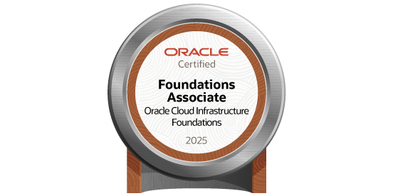
      </a><br/>
      <b>OCI AI Foundations</b><br/>
      <sub>Oracle Cloud Infrastructure</sub><br/>
      <code>ID: 583A2C55...</code><br/><br/>
      <a href="https://catalog-education.oracle.com/pls/certview/sharebadge?id=583A2C556587045564EC7DFDFF0777BE121AB1EA85F963230EF0C8677737E90A">
        
      </a>
    </td>
    <td align="center" width="25%">
      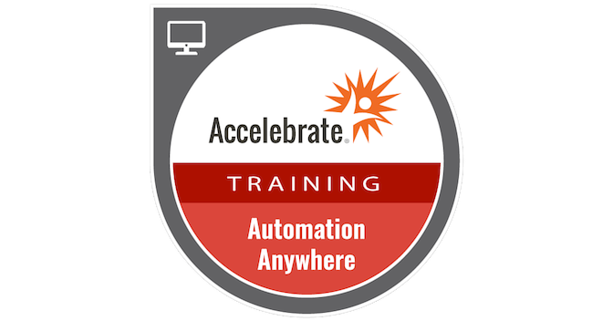<br/>
      <b>Advanced RPA Professional</b><br/>
      <sub>Automation Anywhere (360)</sub><br/>
      <code>RPA Bot Engineering</code><br/><br/>
      
    </td>
    <td align="center" width="25%">
      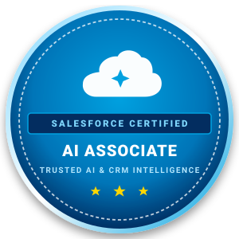<br/>
      <b>Salesforce AI Associate</b><br/>
      <sub>Trusted AI & CRM &bull; Salesforce</sub><br/>
      <code>Certified AI</code><br/><br/>
      
    </td>
    <td align="center" width="25%">
      <br/><br/>
      <b>7+ Verified Credentials</b><br/>
      <sub>AWS &bull; Red Hat &bull; Oracle<br/>Aviatrix &bull; Salesforce &bull; AA</sub><br/><br/>
      
    </td>
  </tr>
</table>

</div>

---

## 🛠️ Technical Arsenal // Weaponry

<div align="center">

| Operational Domain | Weaponry & Technical Arsenal |
|:---|:---|
| **Cloud & Distributed SRE** |       |
| **Observability & Reliability** |     |
| **Systems & Core Languages** |       |
| **Agentic AI & Web3 Rails** |     |
| **Graphics, Vision & UI** |      |
| **Data Engine & Storage** |     |

</div>

---

## 📊 Arcade Leaderboard // Telemetry

<div align="center">

<table>
  <tr>
    <td width="50%">
      
    </td>
    <td width="50%">
      
    </td>
  </tr>
  <tr>
    <td colspan="2" align="center">
      
    </td>
  </tr>
</table>

<p align="center">
  
</p>

</div>

---

## 🕹️ INSERT COIN TO CONNECT

<div align="center">

```
   GAME OVER? NEVER. READY TO LAUNCH MISSION-CRITICAL CLOUD & AI INFRASTRUCTURE.
```

<a href="https://ramprasadatluri.dev">
  
</a>
&nbsp;
<a href="mailto:root@ramprasadatluri.dev">
  
</a>
&nbsp;
<a href="https://github.com/ATLURI0001">
  
</a>
&nbsp;
<a href="https://linkedin.com">
  
</a>

<br/><br/>

<sub>Engineered with maximalist precision by <b>Ram Prasad Atluri</b> &bull; Architected for low-latency & resilience &bull; 2026</sub>

</div>
